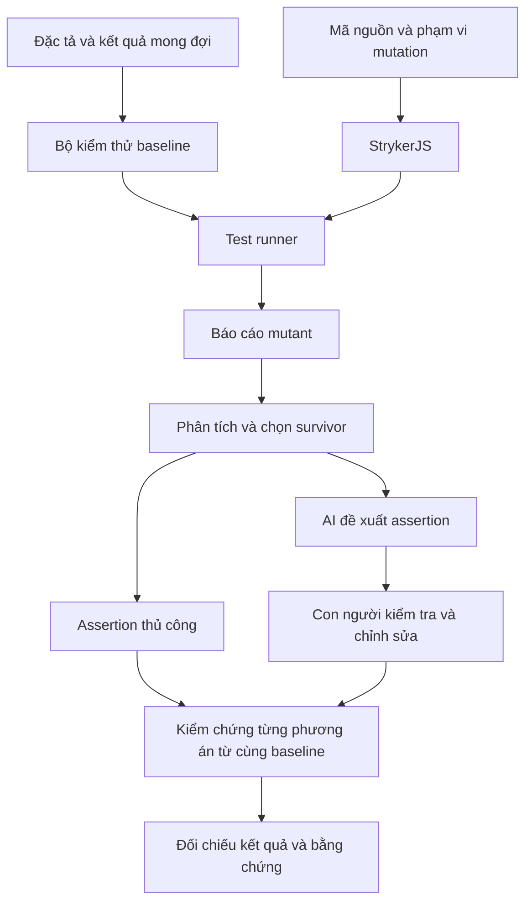

**BÁO CÁO SEMINAR**

**ĐẠI HỌC QUỐC GIA THÀNH PHỐ HỒ CHÍ MINH**  
**TRƯỜNG ĐẠI HỌC KHOA HỌC TỰ NHIÊN**  
**KHOA CÔNG NGHỆ THÔNG TIN**

**Môn học: Kiểm thử phần mềm**

# KIỂM THỬ ĐỘT BIẾN VÀ HIỆU QUẢ CỦA BỘ KIỂM THỬ

**Mutation Testing & Test Effectiveness**  
**Chủ đề T10 · Nhóm 12**

| Thành viên | Mã số sinh viên |
|---|---|
| Lê Tấn Hiệp | |
| Tống Dương Thái Hòa | |
| Nguyễn Phúc Hoàng | |

| Thông tin | Nội dung |
|---|---|
| Giảng viên hướng dẫn | |
| Lớp học phần | |
| Năm học | 2026–2027 |

## Tóm tắt

Đánh giá một bộ kiểm thử đòi hỏi xem xét cả phạm vi thực thi và khả năng nhận biết hành vi sai. Một kiểm thử có thể đi qua đoạn mã cần kiểm tra nhưng vẫn bỏ sót sai lệch nếu dữ liệu đầu vào chưa phân biệt được các trường hợp hoặc điều kiện kiểm tra kết quả chưa đủ cụ thể. Kiểm thử đột biến tiếp cận vấn đề này bằng cách tạo những thay đổi nhỏ trong chương trình và quan sát phản ứng của bộ kiểm thử.

Trong báo cáo này, chúng tôi trình bày cơ sở lý thuyết của kiểm thử đột biến, khảo sát công cụ và xây dựng thiết kế nghiên cứu trường hợp trên EShop backend. Phạm vi bao gồm giỏ hàng và đơn hàng, mã giảm giá, xác thực và người dùng. StrykerJS đảm nhiệm việc sinh đột biến và thực thi kiểm thử; AI Agent hỗ trợ đề xuất assertion. Thiết kế so sánh gồm bộ kiểm thử ban đầu, bộ bổ sung assertion thủ công và bộ bổ sung assertion do AI đề xuất sau khi được con người kiểm tra. Các phương án sử dụng cùng mã nguồn sản phẩm và cấu hình đột biến để đối chiếu kết quả ở mức từng mutant, đồng thời xem xét các trường hợp nghi ngờ tương đương và giới hạn của phép đo.

<!-- Bổ sung kết quả định lượng chính và kết luận thực nghiệm sau khi hoàn thành Chương 6–7. Không nêu hiệu quả vượt trội của bất kỳ phương án nào khi chưa có số liệu. -->

**Từ khóa:** kiểm thử đột biến; hiệu quả kiểm thử; StrykerJS; assertion; AI Agent; EShop.

## Mục lục

- [1. Giới thiệu](#chuong-1)
- [2. Cơ sở lý thuyết và nghiên cứu liên quan](#chuong-2)
- [3. Khảo sát và lựa chọn công cụ](#chuong-3)
- [4. Đối tượng và thiết kế thực nghiệm](#chuong-4)
- [5. Quy trình triển khai và các kịch bản minh họa](#chuong-5)
- [6. Kết quả thực nghiệm](#chuong-6)
- [7. Thảo luận và giới hạn](#chuong-7)
- [8. Kết luận và hướng phát triển](#chuong-8)
- [Tài liệu tham khảo](#tai-lieu-tham-khao)
- [Phụ lục A. Thông tin tái lập thực nghiệm](#phu-luc-a)
- [Phụ lục B. Danh mục bằng chứng](#phu-luc-b)
- [Phụ lục C. Mẫu đầu vào và hồ sơ xử lý kết quả AI](#phu-luc-c)
- [Phụ lục D. Demo và hoạt động thực hành](#phu-luc-d)
- [Phụ lục E. Đóng góp và công bố sử dụng AI](#phu-luc-e)

## Danh mục từ viết tắt và thuật ngữ

| Ký hiệu / thuật ngữ | Diễn giải |
|---|---|
| AI | Trí tuệ nhân tạo (Artificial Intelligence) |
| API | Giao diện lập trình ứng dụng (Application Programming Interface) |
| LLM | Mô hình ngôn ngữ lớn (Large Language Model) |
| SUT | Hệ thống được kiểm thử (System Under Test) |
| RQ | Câu hỏi nghiên cứu (Research Question) |
| Baseline | Mốc đối chiếu gồm trạng thái mã nguồn, cấu hình, dữ liệu và bộ kiểm thử ban đầu đã cố định |
| Test oracle | Căn cứ xác định kết quả mong đợi của kiểm thử |
| Assertion | Điều kiện kiểm tra kết quả thực tế so với kết quả mong đợi |
| Mutation operator | Quy tắc tạo thay đổi trong chương trình |
| Mutant | Một biến thể chương trình được tạo bởi phép đột biến |
| Equivalent candidate | Mutant nghi ngờ tương đương, chưa có đủ căn cứ kết luận |
| Run | Một lần thực thi được định danh và lưu lại điều kiện cùng kết quả |

<a id="chuong-1"></a>
## 1. Giới thiệu

### 1.1. Bối cảnh và vấn đề

Kiểm thử tự động giúp kiểm tra hành vi phần mềm sau mỗi thay đổi. Tuy nhiên, việc toàn bộ kiểm thử đều thành công chưa trả lời được bộ kiểm thử có đủ nhạy với các lỗi quan trọng hay không. Một nguyên nhân là kiểm thử chỉ quan sát một phần kết quả: chẳng hạn xác nhận API trả về trường tổng tiền nhưng không kiểm tra giá trị tổng tiền theo quy tắc nghiệp vụ.

Độ bao phủ mã nguồn cho biết các thành phần mã nào được thực thi. Thông tin này hỗ trợ tìm vùng chưa được kiểm tra, nhưng cần kết hợp với đánh giá dữ liệu đầu vào và assertion. Kiểm thử đột biến bổ sung một góc nhìn bằng cách đặt câu hỏi: khi hành vi của chương trình bị thay đổi, bộ kiểm thử có nhận biết được thay đổi đó hay không [1], [7].

### 1.2. Động cơ lựa chọn đề tài

Trong EShop, sai lệch nhỏ tại điều kiện biên hoặc phép tính có thể ảnh hưởng đến số tiền thanh toán, quyền truy cập hoặc trạng thái đơn hàng. Các trường hợp này phù hợp để phân tích quan hệ giữa yêu cầu nghiệp vụ, dữ liệu kiểm thử và khả năng phát hiện lỗi.

Sự xuất hiện của AI Agent tạo thêm một phương án xây dựng assertion. Câu hỏi cần kiểm chứng là assertion được đề xuất có dùng đúng kết quả mong đợi, chạy được trong môi trường thực tế và phát hiện đúng thay đổi mục tiêu hay không. Vì vậy, chúng tôi đặt việc kiểm tra đầu ra AI trong cùng quy trình thực nghiệm với assertion thủ công.

### 1.3. Mục tiêu

Đề tài hướng đến bốn mục tiêu:

1. Giải thích nguyên lý kiểm thử đột biến, cách đọc kết quả và giới hạn của mutation score.
2. Thiết lập quy trình áp dụng StrykerJS trên phạm vi EShop được lựa chọn.
3. Phân tích ít nhất ba surviving mutants, bổ sung ít nhất ba assertions thủ công và kiểm chứng assertions do AI đề xuất cho cùng các mutant [14].
4. Xây dựng tài liệu và bằng chứng đủ để người khác hiểu, thực hành và kiểm tra lại các kết luận.

### 1.4. Câu hỏi nghiên cứu

**RQ1.** Các mutant được lựa chọn sống sót vì thiếu dữ liệu phân biệt, thiếu quan sát kết quả hay nguyên nhân nào khác?

**RQ2.** Trên cùng baseline và cùng tập mutant mục tiêu, assertion thủ công và assertion có AI hỗ trợ sau review phát hiện được những thay đổi hành vi nào?

**RQ3.** Những mutant còn lại, sai sót của đầu ra AI và điều kiện thực thi giới hạn cách diễn giải kết quả ra sao?

**RQ4.** Những thông tin và bước kiểm chứng nào cần thiết để thành viên khác tái lập quy trình?

### 1.5. Đối tượng và phạm vi

Đối tượng nghiên cứu là bộ kiểm thử cho EShop backend trong ba miền: Cart & Orders, Coupons và Authentication & Users. Chúng tôi tập trung vào quan sát hành vi ở phạm vi được xác định từ đặc tả API, dữ liệu đầu vào và kết quả lưu trữ liên quan. Các endpoint, tệp nguồn và điều kiện nghiệp vụ được chọn cần được ghi cụ thể trong hồ sơ thực nghiệm.

Thiết kế này đánh giá khả năng phát hiện các đột biến được sinh trong phạm vi cấu hình. Việc suy rộng đến lỗi thực tế hoặc hệ thống khác cần thêm bằng chứng. AI Agent được nghiên cứu ở vai trò đề xuất assertion và hỗ trợ lập luận; sinh mutant bằng AI nằm ngoài phép so sánh chính. Agent và model thực tế được ghi riêng cho từng lần sử dụng.

### 1.6. Bố cục báo cáo

Chương 2 trình bày lý thuyết và các nghiên cứu liên quan. Chương 3 khảo sát, lựa chọn và giải thích vai trò công cụ. Chương 4 xác định thiết kế thực nghiệm; Chương 5 mô tả quy trình triển khai. Chương 6 dành cho kết quả, Chương 7 phân tích ý nghĩa và giới hạn, Chương 8 tổng kết đề tài. Các phụ lục lưu thông tin tái lập, bằng chứng, hồ sơ AI và đóng góp thành viên.

<a id="chuong-2"></a>
## 2. Cơ sở lý thuyết và nghiên cứu liên quan

### 2.1. Độ bao phủ, test oracle và assertion

Một test case gồm trạng thái ban đầu, dữ liệu hoặc thao tác kích hoạt hành vi, và điều kiện đánh giá kết quả. Test oracle cung cấp căn cứ cho điều kiện đánh giá đó. Trong đề tài này, oracle xuất phát từ yêu cầu nghiệp vụ đã được làm rõ; mã nguồn hiện tại là đối tượng đối chiếu, không tự động trở thành định nghĩa hành vi đúng.

Chẳng hạn, một kiểm thử xác nhận phản hồi có thuộc tính `discount` mới chỉ kiểm tra sự hiện diện của dữ liệu. Để đánh giá phép tính, cần xác định giá trị mong đợi, đơn vị, quy tắc làm tròn và các điều kiện áp dụng. Một assertion đúng cú pháp nhưng sử dụng giá trị mong đợi sai vẫn có thể làm giảm giá trị của bộ kiểm thử.

Trong báo cáo, code coverage và mutation score được trình bày như những thông tin bổ sung cho nhau. Việc bổ sung dữ liệu đầu vào có thể thay đổi coverage; việc thay đổi assertion có thể nâng khả năng phát hiện sai lệch ngay cả khi tập dòng mã được thực thi không đổi.

### 2.2. Khái niệm và quy trình kiểm thử đột biến

Kiểm thử đột biến tạo các biến thể của chương trình bằng những phép thay đổi được quy định trước, rồi dùng bộ kiểm thử để đánh giá chúng. Một mutant bị phát hiện khi kiểm thử nhận biết được sai khác do biến thể gây ra. Công trình tổng quan của Jia và Harman hệ thống hóa nền tảng và các hướng phát triển của phương pháp này [1].

Quy trình khái quát gồm: xác nhận bộ kiểm thử chạy trên chương trình gốc; sinh mutant trong phạm vi đã chọn; thực thi kiểm thử với mutant; tổng hợp trạng thái; phân tích nguyên nhân và cải thiện kiểm thử. Khi đọc kết quả, cần kiểm tra cả vị trí đột biến lẫn điều kiện đã sử dụng để chạy kiểm thử.

### 2.3. Toán tử đột biến

Toán tử mô tả một loại biến đổi; mutant là một lần áp dụng cụ thể của toán tử tại một vị trí. Các nhóm dưới đây minh họa những biến đổi trong danh mục mutator của Stryker [3].

**Bảng 2.1. Nhóm đột biến và hướng thiết kế quan sát.**

| Nhóm | Ví dụ biến đổi | Quan sát có thể phân biệt |
|---|---|---|
| Số học | `a - b` thành `a + b` | Giá trị tính toán |
| So sánh | `a >= b` thành `a > b` | Trường hợp bằng ngưỡng |
| Logic | `a && b` thành `a \|\| b` | Một điều kiện đúng, điều kiện còn lại sai |
| Boolean | `true` thành `false` | Nhánh hành vi được kích hoạt |
| Khối lệnh | Thay thân khối bằng khối rỗng | Tác động hoặc dữ liệu bắt buộc |
| Chuỗi / tập hợp | Thay nội dung bằng giá trị rỗng | Nội dung phản hồi hoặc phần tử cần tồn tại |

Bảng trên dùng để giải thích cách thiết kế kiểm thử. Danh sách mutant thực tế của EShop phải được lấy từ báo cáo của lần chạy tương ứng.

### 2.4. Điều kiện phát hiện thay đổi hành vi

Trong quá trình phân tích, chúng tôi sử dụng ba câu hỏi: kiểm thử có đi đến vị trí bị thay đổi không; dữ liệu có làm chương trình gốc và mutant tạo ra trạng thái khác nhau không; assertion có quan sát được sai khác đó không. Cách phân tích này giúp chuyển một survivor thành vấn đề cụ thể cần giải quyết.

Xét ví dụ minh họa độc lập với EShop: đơn hàng đủ điều kiện khi giá trị đạt tối thiểu 500 đơn vị. Hàm gốc và một mutant giả định là:

```javascript
// Ví dụ lý thuyết, không phải mã hoặc kết quả thực nghiệm EShop.
function eligible(amount) {
  return amount >= 500;
}

// Mutant giả định: return amount > 500;
```

**Bảng 2.2. Dữ liệu phân biệt tại biên của ví dụ.**

| Đầu vào | Kết quả theo quy tắc | Chương trình gốc | Mutant giả định |
|---|---|---|---|
| 499 | `false` | `false` | `false` |
| 500 | `true` | `true` | `false` |
| 501 | `true` | `true` | `true` |

Nếu chỉ dùng 499 và 501, kiểm thử không phân biệt hai phiên bản. Với đầu vào 500, assertion kiểm tra chính xác kết quả `true` nhận biết được thay đổi. Nếu chỉ kiểm tra kiểu dữ liệu Boolean, đầu vào đúng biên vẫn chưa đủ. Các giá trị trong bảng được suy ra trực tiếp từ hai biểu thức; chúng không phải số liệu của một lần chạy công cụ.

### 2.5. Trạng thái mutant và mutation score

Các trạng thái và công thức dưới đây theo tài liệu Stryker [2].

**Bảng 2.3. Các trạng thái cần đọc trong mutation report.**

| Trạng thái | Ý nghĩa |
|---|---|
| `Killed` | Có kiểm thử thất bại khi mutant hoạt động |
| `Survived` | Các kiểm thử được chạy đều thành công |
| `No coverage` | Không được kiểm thử bao phủ |
| `Timeout` | Thực thi vượt giới hạn thời gian |
| `Runtime error` / `Compile error` | Lỗi thực thi công cụ hoặc biên dịch |
| `Ignored` | Được bỏ qua |
| `Pending` | Chưa có kết quả thực thi cuối |

Đặt `K`, `T`, `S`, `N` lần lượt là số `Killed`, `Timeout`, `Survived`, `No coverage`. Công thức mutation score của Stryker là:

```text
V = K + T + S + N
Mutation score (%) = 100 × (K + T) / V, với V > 0
```

Các trạng thái lỗi, bỏ qua và chưa chạy được báo riêng. Khi `V = 0`, cần giữ cách biểu diễn của công cụ và giải thích rõ.

Trong phép so sánh của nhóm, số mutant chuyển sang `Killed` được đối chiếu thêm với kiểm thử gây thất bại. `Timeout` không được dùng làm bằng chứng rằng assertion đã quan sát đúng sai khác nghiệp vụ.

### 2.6. Equivalent mutants

Mutant tương đương giữ nguyên hành vi quan sát được so với chương trình gốc trong miền đầu vào đang xét. Vì vậy, một survivor có thể phản ánh sự tương đương thay vì thiếu kiểm thử. Stryker minh họa rằng một thay đổi điều kiện có thể không làm thay đổi kết quả cuối cùng [4].

Chúng tôi sử dụng nhãn *equivalent candidate* khi chưa đủ căn cứ kết luận. Việc phân tích cần nêu miền dữ liệu hợp lệ, trạng thái có thể đạt tới và những đầu ra hoặc tác động được quan sát. Thử một số đầu vào và không tìm thấy khác biệt chỉ là bằng chứng trong các trường hợp đã thử. Giải thích do AI tạo ra cũng cần được kiểm tra theo cùng tiêu chí.

### 2.7. Vai trò của AI trong kiểm thử đột biến

Cần phân biệt ba nhiệm vụ: sinh assertion hoặc test; hỗ trợ nhận diện mutant tương đương; và sinh mutant. Trong thiết kế này, nhiệm vụ chính là đề xuất assertion từ đặc tả, mã nguồn, kiểm thử ban đầu và mutant mục tiêu. Sản phẩm được đánh giá là kiểm thử sau review cùng khả năng phát hiện mutant của nó.

Chúng tôi phân biệt đầu ra AI nguyên gốc với phiên bản được sửa trước khi chạy. Nếu con người phải thay oracle hoặc viết lại phần kiểm tra chính, thông tin đó cần xuất hiện trong kết quả. Khi đó, hiệu quả đo được thuộc quy trình có AI hỗ trợ và con người kiểm chứng; mức đóng góp của bản đề xuất nguyên gốc được mô tả riêng.

### 2.8. Nghiên cứu liên quan

**Bảng 2.4. Các nguồn nghiên cứu và liên hệ với đề tài.**

| Nghiên cứu | Nội dung được sử dụng | Liên hệ với thiết kế của nhóm |
|---|---|---|
| Jia và Harman [1] | Tổng quan nền tảng và phát triển của kiểm thử đột biến | Đặt khái niệm, toán tử và vấn đề tương đương trong bối cảnh nghiên cứu |
| Petrović và Ivanković [9] | Phân tích đột biến theo thay đổi mã và lựa chọn vị trí có ích tại Google | Ghi rõ phạm vi lựa chọn và các loại trừ để diễn giải đúng kết quả |
| Wang và cộng sự [10] | MUTGEN sử dụng phản hồi mutation trong quá trình sinh unit test bằng LLM | Đưa mutant cụ thể vào đầu vào AI và kiểm chứng kết quả thực thi |
| Tian và cộng sự [11] | Đánh giá LLM cho nhận diện mutant tương đương | Xem nhận định của mô hình là đối tượng cần đánh giá |

Các công trình trên cung cấp nền tảng và hướng tiếp cận. Nghiên cứu EShop có phạm vi, ngôn ngữ, dữ liệu và điều kiện sử dụng AI riêng; kết quả từ công trình khác không được chuyển thành kết quả của nhóm. Phần tổng hợp [9]–[11] sử dụng thông tin mô tả phương pháp trên trang công bố; báo cáo không thực hiện tái lập các nghiên cứu đó.

<a id="chuong-3"></a>
## 3. Khảo sát và lựa chọn công cụ

### 3.1. Tiêu chí đánh giá

Chúng tôi xem xét công cụ theo năm tiêu chí: chi phí và điều kiện sử dụng; yêu cầu kiến thức khi tiếp cận; mức phù hợp với EShop; vai trò hỗ trợ AI; tài liệu và cộng đồng hỗ trợ. Phép so sánh cần phân biệt khả năng được tài liệu công cụ mô tả với khả năng đã được kiểm chứng trên hệ thống cụ thể.

Đối với đề tài này, tính phù hợp với ngôn ngữ backend và khả năng truy vết kết quả là hai điều kiện quan trọng. Các nhận xét về tốc độ, mức dễ học hoặc chi phí sử dụng thực tế cần gắn với môi trường, phiên bản và tài khoản đã dùng. Thời gian làm quen chưa được đo không được trình bày như số liệu thực nghiệm.

### 3.2. Các công cụ truyền thống

**Bảng 3.1. Đối chiếu các ứng viên theo hệ sinh thái.**

| Công cụ | Hệ sinh thái | Vai trò trong khảo sát | Đánh giá đối với EShop backend |
|---|---|---|---|
| StrykerJS [5] | JavaScript / TypeScript, gồm Node.js | Ứng viên thực thi mutation chính | Phù hợp về ngôn ngữ; cần tích hợp với bộ kiểm thử |
| PIT [7] | Java / JVM | Công cụ đối chiếu trong hệ sinh thái khác | Không trực tiếp thực thi trên backend JavaScript |
| mutmut [8] | Python | Công cụ đối chiếu và hướng lựa chọn khi SUT dùng Python | Không trực tiếp thay StrykerJS trên SUT hiện tại |

Phạm vi này kế thừa khảo sát công cụ của nhóm, đồng thời tập trung vào những đặc điểm ảnh hưởng đến lựa chọn cho EShop. Việc PIT hoặc mutmut không phù hợp trực tiếp về ngôn ngữ không phải đánh giá chất lượng tổng quát của các công cụ đó.

### 3.3. Hướng hỗ trợ bằng AI

Một AI Agent có thể tiếp nhận ngữ cảnh đặc tả, mã nguồn và mutant để đề xuất kiểm thử. Giao diện sử dụng, model, quyền truy cập tệp và khả năng gọi lệnh phụ thuộc sản phẩm cụ thể. Vì vậy, báo cáo dùng tên vai trò chung trong thiết kế, còn hồ sơ từng lần sử dụng ghi đúng agent và model thực tế.

Các hướng hỗ trợ được phân biệt theo đầu ra: đề xuất dữ liệu kiểm thử, viết assertion, giải thích nguyên nhân survivor hoặc đưa ra giả thuyết về tính tương đương. Chỉ các assertion được đưa qua quy trình kiểm chứng mới tham gia phép so sánh thực nghiệm chính.

### 3.4. Ma trận đánh giá và lý do lựa chọn

**Bảng 3.2. Tiêu chí áp dụng cho hai vai trò được lựa chọn.**

| Tiêu chí | StrykerJS | AI Agent |
|---|---|---|
| Chi phí / điều kiện sử dụng | Ghi giấy phép phiên bản và chi phí môi trường thực thi | Ghi sản phẩm, loại truy cập và giới hạn tài khoản thực tế |
| Kiến thức cần có | Tests, runner, cấu hình và đọc mutation report | Đặc tả, thiết kế prompt và kiểm tra mã được đề xuất |
| Phù hợp với EShop | Hỗ trợ hệ sinh thái JavaScript / Node.js [5] | Đánh giá qua tính đúng và khả năng chạy của từng candidate |
| Vai trò AI | Cung cấp phản hồi thực thi cho quy trình | Đề xuất assertion và giải thích |
| Tài liệu / hỗ trợ | Tài liệu chính thức về cấu hình, runner và reports [6], [12], [13] | Ghi nguồn hướng dẫn của sản phẩm được sử dụng |

Lựa chọn StrykerJS và AI Agent dựa trên ba lý do: công cụ thực thi phù hợp với backend JavaScript; kết quả mutation tạo căn cứ cụ thể để cải thiện kiểm thử; và quy trình cho phép đối chiếu đề xuất AI với phương án thủ công trên cùng mục tiêu. Danh tính và điều kiện sử dụng công cụ thực tế được điền tại Phụ lục A.

### 3.5. Chức năng và kiến trúc StrykerJS

StrykerJS là công cụ kiểm thử đột biến cho các dự án JavaScript và TypeScript [5]. Trong luồng tích hợp, phần lõi phối hợp tạo đột biến và thực thi, test runner chạy bộ kiểm thử, còn reporter trình bày kết quả. Stryker cung cấp các plugin runner và reporter; một số plugin được cài dưới dạng gói riêng [12].

**Hình 3.1. Luồng xử lý khái quát của thực nghiệm.**



Hình 3.1 mô tả thiết kế quy trình. Tính hoạt động của từng thành phần trong môi trường EShop được xác nhận bằng hồ sơ triển khai và run evidence.

### 3.6. Đầu vào, đầu ra và giới hạn của AI Agent

Đầu vào AI cần chứa phần đặc tả liên quan, mã nguồn trong phạm vi, kiểm thử baseline, mutant mục tiêu và yêu cầu đầu ra. Candidate phải sử dụng API hoặc helper có thật, chuẩn bị dữ liệu hợp lệ và kiểm tra kết quả có căn cứ.

Đầu ra được lưu trước khi chỉnh sửa để bảo toàn quá trình đánh giá. Các thay đổi của người thực hiện phải chỉ rõ là sửa cú pháp, fixture, cách gọi API hay logic assertion. Việc một agent có thể gọi lệnh không thay thế yêu cầu kiểm tra lệnh đã chạy, trạng thái nguồn và báo cáo thực tế.

### 3.7. Mức tự động hóa

Quy trình được thiết kế theo hướng bán tự động: công cụ thực hiện phần chạy kiểm thử và tổng hợp trạng thái; con người xác định oracle, lựa chọn phạm vi, kiểm tra candidate và diễn giải survivor. Khả năng tái sử dụng nằm ở cấu hình được lưu, mẫu đầu vào AI và quy trình xác minh thống nhất. Mỗi lần áp dụng cho nghiệp vụ mới vẫn cần thay dữ liệu và kết quả mong đợi theo đặc tả.

<a id="chuong-4"></a>
## 4. Đối tượng và thiết kế thực nghiệm

### 4.1. Tổng quan EShop backend

EShop là hệ thống thương mại điện tử dùng làm SUT của seminar. Đặc tả API mô tả các nhóm chức năng xác thực, người dùng, giỏ hàng, đơn hàng và mã giảm giá [15]. Trong mã nguồn được đối chiếu khi biên soạn, backend sử dụng JavaScript, Express và SQLite; các phụ thuộc được khai báo trong `backend/package.json` [16].

Đối với thực nghiệm, một phản hồi HTTP có thể chưa mô tả toàn bộ hành vi. Khi yêu cầu liên quan đến lưu trữ hoặc cập nhật trạng thái, kiểm thử cần quan sát dữ liệu sau thao tác. Phạm vi quan sát phải được nêu trước khi phân loại mutant.

### 4.2. Phạm vi nghiệp vụ

**Bảng 4.1. Định hướng lựa chọn trường hợp kiểm thử theo miền.**

| Miền | Hành vi cần xem xét | Dữ liệu cần phân biệt | Quan sát cần xác định từ đặc tả |
|---|---|---|---|
| Cart & Orders | Giỏ hàng, tạo đơn, tổng tiền, chuyển trạng thái được chọn | Giỏ hàng hợp lệ; quyền sở hữu; trạng thái trước thao tác | Phản hồi và dữ liệu đơn hàng sau thao tác |
| Coupons | Điều kiện áp dụng, ngưỡng giá trị, thời hạn và cách tính giảm giá | Dưới / bằng / trên ngưỡng; mã hợp lệ / không hợp lệ | Khả năng áp dụng, số tiền và thông tin từ chối |
| Authentication & Users | Xác thực, truy cập, cập nhật thông tin được chọn | Thông tin hợp lệ / không hợp lệ; token; vai trò | Quyền truy cập và trạng thái người dùng |

Đây là ma trận định hướng thiết kế. Danh sách endpoint và test case được đưa vào phép đo chính được điền dưới đây sau khi chốt phạm vi.

| Miền | Endpoint / tệp nguồn | Quy tắc được chọn | Test case | Nguồn xác nhận oracle |
|---|---|---|---|---|
| Cart & Orders | | | | |
| Coupons | | | | |
| Authentication & Users | | | | |

### 4.3. Xác định kết quả mong đợi

Chúng tôi đối chiếu đặc tả và hành vi hiện thực trước khi cố định baseline. Khi hai nguồn không thống nhất hoặc đặc tả chưa rõ, quyết định cần được ghi lại cùng phạm vi áp dụng. Ví dụ, điều kiện bằng ngưỡng, đơn vị phần trăm, thời điểm hết hạn hoặc quyền sửa một trường dữ liệu có thể làm thay đổi oracle.

Một lỗi có sẵn trong chương trình gốc được xử lý như vấn đề của SUT. Nếu cần sửa mã nguồn để thiết lập baseline hợp lệ, bản sửa phải được ghi nhận và dùng chung cho các phương án. Việc sửa sản phẩm trong một nhánh so sánh làm thay đổi đối tượng đo, do đó cần xác lập lại các lần chạy bị ảnh hưởng.

**Bảng 4.2. Các điểm cần làm rõ trước khi cố định baseline.**

| Quy tắc / vị trí | Nội dung chưa thống nhất | Quyết định về hành vi đúng | Căn cứ và người xác nhận |
|---|---|---|---|
| | | | |

### 4.4. Môi trường và trạng thái nguồn

Một baseline có thể tái lập cần xác định commit sản phẩm, các thay đổi chưa commit nếu có, cấu hình, bộ kiểm thử, lockfile và dữ liệu khởi tạo. Phiên bản Node.js, test runner, StrykerJS và hệ điều hành được ghi theo môi trường chạy thực tế. Bảng A.1 lưu những thông tin này.

Các sửa đổi phục vụ khả năng kiểm thử, như kiểm soát vòng đời ứng dụng hoặc tách cơ sở dữ liệu dùng cho test, cần được mô tả riêng với thay đổi assertion. Mọi kết luận so sánh đều phụ thuộc vào việc các phương án sử dụng cùng trạng thái nguồn đã được chấp nhận.

### 4.5. Thiết kế các phương án so sánh

**Bảng 4.3. Ba phương án kiểm thử.**

| Phương án | Thành phần | Điều kiện |
|---|---|---|
| Baseline | Bộ kiểm thử ban đầu đã cố định | Chạy thành công trên chương trình gốc trong phạm vi đã chốt |
| Thủ công | Baseline cộng các kiểm thử / assertions do thành viên thiết kế | Dùng cùng mã nguồn, cấu hình và tập mutant mục tiêu |
| AI hỗ trợ | Baseline cộng các candidates đã được review và chỉnh sửa nếu cần | Không đưa lời giải thủ công vào prompt; ghi rõ phần chỉnh sửa |

Hai phương án cải thiện được xây dựng từ cùng baseline. Phương án AI không kế thừa assertions của phương án thủ công. Chúng tôi vẫn công bố ảnh hưởng có thể có từ việc cùng một người đã đọc hoặc phân tích mutant trước khi review AI.

Nếu cần thay đổi cả đầu vào và assertion để phát hiện mutant, báo cáo ghi đầy đủ hai thay đổi. Số lượng assertion mới, số test case mới và số mutant bị phát hiện là ba đại lượng khác nhau.

### 4.6. Lựa chọn surviving mutants

Theo yêu cầu T10, nhóm phân tích ít nhất ba surviving mutants và bổ sung ít nhất ba assertions thủ công [14]. Tiêu chí lựa chọn gồm: mutant thuộc phạm vi nghiệp vụ đã chốt; có định danh và vị trí truy vết được; có thể phân tích nguyên nhân; và có oracle đủ rõ để kiểm chứng.

Chúng tôi lưu cả các trường hợp không cải thiện được và lý do loại trừ. Nếu baseline không tạo đủ survivor phù hợp, cần xem lại phạm vi hoặc ghi giới hạn của nghiên cứu. Việc thay đổi phạm vi phải được công bố trước một baseline mới; không bỏ kiểm thử hợp lệ chỉ để tạo ra survivor.

### 4.7. Biến và chỉ số đánh giá

Biến thay đổi chính là cách bổ sung kiểm thử. Các điều kiện giữ cố định gồm mã nguồn sản phẩm, phạm vi và toán tử đột biến, môi trường, cấu hình timeout, dữ liệu khởi tạo và cơ chế reset. Danh tính agent/model là đặc điểm của phương án AI được công bố theo từng miền.

**Bảng 4.4. Các chỉ số của thiết kế đánh giá.**

| Chỉ số | Mục đích và cách sử dụng |
|---|---|
| Số lượng mutant theo trạng thái | Cho biết thành phần kết quả của từng phương án |
| Mutation score | Giữ định nghĩa công cụ tại mục 2.5 và mẫu số của từng run |
| Số mutant mục tiêu chuyển từ `Survived` sang `Killed` | Đo thay đổi trên cùng tập mục tiêu, truy tới kiểm thử gây thất bại |
| Số test case và assertion bổ sung | Mô tả quy mô thay đổi của bộ kiểm thử |
| Candidate AI được dùng nguyên, sửa hoặc loại | Mô tả quá trình xử lý đầu ra AI |
| Coverage, nếu có báo cáo | Giúp phân biệt mở rộng phạm vi thực thi với tăng khả năng quan sát |
| Thời gian, nếu được đo | Báo cùng cách đo, số lần chạy và điều kiện môi trường |

Để làm rõ quan hệ giữa kết quả hai phương án, có thể phân nhóm mutant mục tiêu thành: cả hai phát hiện; chỉ thủ công phát hiện; chỉ AI hỗ trợ phát hiện; và cả hai chưa phát hiện. Mỗi trường hợp vẫn giữ trạng thái cụ thể, đặc biệt khi xuất hiện `Timeout` hoặc lỗi công cụ.

### 4.8. Thu thập dữ liệu và tái lập

Mỗi run cần có lệnh chạy, mã thoát, log, cấu hình và báo cáo thô. Định danh mutant dạng số chỉ có ý nghĩa trong báo cáo tương ứng; đối chiếu giữa các run cần thêm tệp nguồn, vị trí, toán tử và đoạn thay thế trên cùng phiên bản sản phẩm.

Kết quả chung được lấy từ lần chạy kết hợp trong phạm vi đã chốt. Không lấy trung bình đơn giản các mutation scores theo miền để tạo score toàn hệ thống. Thành viên chạy lại ghi bằng chứng riêng, những khác biệt môi trường và vấn đề gặp phải; việc đọc hướng dẫn không thay thế kiểm tra tái lập.

<a id="chuong-5"></a>
## 5. Quy trình triển khai và các kịch bản minh họa

### 5.1. Thiết lập môi trường và tích hợp công cụ

Quy trình bắt đầu bằng kiểm tra cấu trúc dự án, package scripts, bộ kiểm thử và phụ thuộc đang có. Chỉ sau khi lệnh kiểm thử thực thi đúng tập test dự kiến mới tiến hành tích hợp mutation. Kết quả cài đặt phải được kiểm tra bằng phiên bản và một lần chạy, thay vì chỉ dựa trên việc xuất hiện package trong tệp khai báo.

Nếu sử dụng Jest, plugin `@stryker-mutator/jest-runner` kết nối Jest với Stryker; phiên bản phải đáp ứng các peer dependencies được công cụ quy định [13]. Cấu hình thực tế và lệnh đã xác minh được điền tại Phụ lục A. Hướng dẫn thao tác chi tiết nằm trong [User Guide](User_Guide.md).

### 5.2. Chuẩn bị dữ liệu và cô lập kiểm thử

Một test case cần xác định trước trạng thái tài khoản, giỏ hàng, đơn hàng hoặc mã giảm giá mà nó sử dụng. Sau khi hoàn tất, dữ liệu phải được khôi phục hoặc loại bỏ theo cơ chế đã chốt. Test không được phụ thuộc vào thứ tự chạy hay trạng thái do một test khác để lại.

Đối với quy tắc thời hạn, cần kiểm soát thời điểm đánh giá. Đối với thao tác ghi dữ liệu, cần chờ thao tác hoàn tất trước khi đọc lại. Khi chạy song song, các worker cần tránh dùng chung dữ liệu có thể thay đổi ngoài ý muốn. Cơ chế cô lập được ghi như một điều kiện của thực nghiệm và áp dụng nhất quán cho cả ba phương án.

### 5.3. Cấu hình và chạy baseline

Stryker cho phép cấu hình phạm vi qua `mutate`, lựa chọn `testRunner`, `reporters`, phân tích coverage và các giới hạn thực thi [6]. Trong nghiên cứu này, cấu hình được lưu cùng run để mọi thay đổi có thể được kiểm tra lại.

Trình tự thiết lập baseline gồm:

1. Xác nhận phiên bản nguồn và các quyết định oracle.
2. Chạy bộ kiểm thử ban đầu trên chương trình gốc, kiểm tra đúng tập test được phát hiện.
3. Thực hiện bước kiểm tra ban đầu của công cụ và xử lý lỗi môi trường.
4. Chạy mutation trong phạm vi đã chọn.
5. Lưu báo cáo và thống kê trạng thái, sau đó chọn survivor theo mục 4.6.

Một lần dry run hoặc tutorial chỉ chứng minh bước tương ứng hoạt động. Baseline mutation cần báo cáo có kết quả cho phạm vi EShop đã chốt.

### 5.4. Phân tích survivor và bổ sung assertion thủ công

Với mỗi survivor, người thực hiện đọc đoạn mã gốc và đoạn thay thế, xác định yêu cầu bị tác động, sau đó tìm đầu vào khiến hai phiên bản khác nhau. Assertion được thiết kế để quan sát sai khác có ý nghĩa nghiệp vụ, chẳng hạn giá trị trả về, quyền thực hiện thao tác hoặc dữ liệu sau cập nhật.

Kiểm thử mới phải thành công trên chương trình gốc. Nếu nó thất bại ngay từ đây, cần xác định lỗi của test, dữ liệu hoặc SUT trước khi đánh giá mutant. Khi mutant bị phát hiện, phải kiểm tra nguyên nhân thất bại để tránh quy nhầm lỗi thiết lập thành tác dụng của assertion.

### 5.5. Đề xuất assertion bằng AI và kiểm tra đầu ra

AI nhận cùng mutant mục tiêu và thông tin baseline theo mẫu ở Phụ lục C. Người thực hiện lưu đầu ra nguyên gốc, rồi kiểm tra lần lượt: oracle có căn cứ; API/helper tồn tại; dữ liệu hợp lệ; kiểm thử có quan sát đúng sai khác; và giải thích có phù hợp với mã hay không.

Candidate được phân thành dùng nguyên, chỉnh sửa hoặc loại bỏ. Nếu sửa, cần lưu nội dung trước và sau cùng lý do. Những phân loại này phục vụ thực nghiệm, không tự thay thế verdict trên biểu mẫu AI audit chính thức. Hồ sơ phải ghi agent, model, ngữ cảnh được cung cấp và các lần yêu cầu sửa lại.

### 5.6. Kiểm chứng và lưu kết quả

Mỗi phương án được kiểm tra trên mã gốc rồi chạy mutation với cùng cấu hình. Việc chạy riêng mutant hoặc vùng mã mục tiêu hỗ trợ phân tích, nhưng báo cáo kết quả tổng hợp cần lần chạy đủ phạm vi tương ứng. Nếu test mới ảnh hưởng ngoài mutant mục tiêu, kết quả đó cũng được giữ lại.

Bằng chứng cho một kết luận gồm đặc tả, phiên bản nguồn, thay đổi kiểm thử, lệnh, báo cáo và vị trí mutant. Ảnh chụp màn hình hỗ trợ trình bày; báo cáo thô và log cho phép kiểm tra lại các con số. Danh mục bằng chứng được ghi tại Phụ lục B.

### 5.7. Kịch bản minh họa công cụ

**Bảng 5.1. Thiết kế các kịch bản theo mức sử dụng.**

| Vai trò | Mức | Nội dung | Điểm kiểm tra | Bằng chứng thực hiện |
|---|---|---|---|---|
| StrykerJS | Thiết lập | Cài phụ thuộc, tích hợp runner và cấu hình phạm vi | Công cụ nhận đúng tests và nguồn | |
| StrykerJS | Cơ bản | Chạy baseline và đọc một survivor | Chỉ ra vị trí, thay đổi và trạng thái | |
| StrykerJS | Nâng cao | Chạy lại sau cải thiện và đối chiếu kết quả | Cùng baseline; truy được test phát hiện mutant | |
| AI Agent | Thiết lập | Chuẩn bị truy cập và ngữ cảnh đầu vào | Ghi agent/model và phạm vi dữ liệu | |
| AI Agent | Cơ bản | Đề xuất assertion cho một survivor | Lưu đầu ra và kiểm tra oracle | |
| AI Agent | Nâng cao | Review, sửa hoặc loại candidate; chạy kiểm chứng | Liên hệ candidate cuối với kết quả mutation | |

Bảng 5.1 mô tả kịch bản, chưa xác nhận việc trình diễn đã hoàn tất. Chi tiết điều phối và media được bổ sung trong [Demo Script](Demo_Script.md) và Phụ lục D.

### 5.8. Data-driven testing, checkpoints và tái sử dụng

Data-driven testing được thể hiện bằng một cấu trúc test chạy với nhiều bộ dữ liệu có kết quả mong đợi riêng. Với điều kiện biên, dữ liệu cần bao gồm trường hợp dưới, tại và trên biên nếu thuộc miền hợp lệ. Checkpoints được hiện thực bằng assertions kiểm tra phản hồi và tác động theo yêu cầu.

Trong phạm vi quy trình này, Record & Playback không được triển khai như cơ chế ghi và phát lại thao tác giao diện. Chạy lại test script hoặc mở lại report không được gọi là GUI recording. Quy trình tái sử dụng thông qua cấu hình, dữ liệu và mẫu prompt đã lưu; người thực hiện thay phần đặc tả, mutant và oracle khi áp dụng cho trường hợp mới.

<a id="chuong-6"></a>
## 6. Kết quả thực nghiệm

<!-- Điền chỉ từ run evidence đã kiểm tra. Các bảng trống giữ chỗ cho kết quả; không dùng số liệu tutorial hoặc ví dụ Chương 2 làm kết quả EShop. -->

### 6.1. Kết quả baseline

**Bảng 6.1. Thông tin kiểm thử ban đầu.**

| Miền | Run ID | Phiên bản nguồn | Số tests | Tests thành công | Coverage và loại đo | Report |
|---|---|---|---|---|---|---|
| Cart & Orders | | | | | | |
| Coupons | | | | | | |
| Authentication & Users | | | | | | |
| Phạm vi kết hợp | | | | | | |

**Bảng 6.2. Kết quả mutation baseline.**

| Phạm vi | Killed | Survived | No coverage | Timeout | Lỗi / bỏ qua / chưa chạy | V | Score (%) | Run ID |
|---|---|---|---|---|---|---|---|---|
| Cart & Orders | | | | | | | | |
| Coupons | | | | | | | | |
| Authentication & Users | | | | | | | | |
| Phạm vi kết hợp | | | | | | | | |

<!-- Bổ sung mô tả phân bố mutant và những quan sát nổi bật của baseline. Giải thích từng trạng thái trong cột gộp nếu có. -->

### 6.2. Phân tích surviving mutants

#### 6.2.1. Trường hợp thứ nhất

| Nội dung | Kết quả phân tích |
|---|---|
| Miền, Run ID và mutant ID | |
| Tệp, vị trí và toán tử | |
| Yêu cầu nghiệp vụ và nguồn oracle | |
| Mã gốc | |
| Mã sau đột biến | |
| Trạng thái và nguyên nhân baseline chưa phát hiện | |
| Dữ liệu phân biệt và kết quả mong đợi | |
| Assertion thủ công và kiểm thử liên quan | |
| Candidate AI nguyên gốc | |
| Chỉnh sửa / quyết định review | |
| Kết quả trên mã gốc và mutant của từng phương án | |
| Bằng chứng và giới hạn diễn giải | |

#### 6.2.2. Trường hợp thứ hai

| Nội dung | Kết quả phân tích |
|---|---|
| Miền, Run ID và mutant ID | |
| Tệp, vị trí và toán tử | |
| Yêu cầu nghiệp vụ và nguồn oracle | |
| Mã gốc | |
| Mã sau đột biến | |
| Trạng thái và nguyên nhân baseline chưa phát hiện | |
| Dữ liệu phân biệt và kết quả mong đợi | |
| Assertion thủ công và kiểm thử liên quan | |
| Candidate AI nguyên gốc | |
| Chỉnh sửa / quyết định review | |
| Kết quả trên mã gốc và mutant của từng phương án | |
| Bằng chứng và giới hạn diễn giải | |

#### 6.2.3. Trường hợp thứ ba

| Nội dung | Kết quả phân tích |
|---|---|
| Miền, Run ID và mutant ID | |
| Tệp, vị trí và toán tử | |
| Yêu cầu nghiệp vụ và nguồn oracle | |
| Mã gốc | |
| Mã sau đột biến | |
| Trạng thái và nguyên nhân baseline chưa phát hiện | |
| Dữ liệu phân biệt và kết quả mong đợi | |
| Assertion thủ công và kiểm thử liên quan | |
| Candidate AI nguyên gốc | |
| Chỉnh sửa / quyết định review | |
| Kết quả trên mã gốc và mutant của từng phương án | |
| Bằng chứng và giới hạn diễn giải | |

### 6.3. Kết quả bổ sung assertion thủ công

**Bảng 6.3. Assertions thủ công và mutant mục tiêu.**

| Assertion / test | Quy tắc được kiểm tra | Dữ liệu bổ sung | Mutant mục tiêu | Kết quả trên mã gốc | Kết quả mutant | Run / bằng chứng |
|---|---|---|---|---|---|---|
| | | | | | | |
| | | | | | | |
| | | | | | | |

<!-- Bổ sung nhận xét về tác dụng của từng assertion, kể cả trường hợp chưa phát hiện được mutant. -->

### 6.4. Kết quả assertion có AI hỗ trợ

**Bảng 6.4. Candidate AI và kết quả sau review.**

| Candidate | Agent / model | Mutant mục tiêu | Dùng nguyên / sửa / loại | Nội dung sửa và lý do | Kết quả bản gốc nếu đã chạy | Kết quả bản cuối | Bằng chứng |
|---|---|---|---|---|---|---|---|
| | | | | | | | |

<!-- Công bố cả candidates không hợp lệ hoặc bị loại. Không suy ra kết quả thực thi của bản nguyên gốc từ kết quả của bản đã sửa. -->

### 6.5. So sánh ba phương án

**Bảng 6.5. Đối chiếu ở mức mutant.**

| Mutant / vị trí đối chiếu | Baseline | Thủ công | AI hỗ trợ | Test phát hiện | Giải thích khác biệt | Reports |
|---|---|---|---|---|---|---|
| | | | | | | |

**Bảng 6.6. Đối chiếu chỉ số trong cùng phạm vi.**

| Miền / phạm vi | Phương án | Killed | Survived | No coverage | Timeout | V | Score (%) | Run ID |
|---|---|---|---|---|---|---|---|---|
| Cart & Orders | Baseline | | | | | | | |
| Cart & Orders | Thủ công | | | | | | | |
| Cart & Orders | AI hỗ trợ | | | | | | | |
| Coupons | Baseline | | | | | | | |
| Coupons | Thủ công | | | | | | | |
| Coupons | AI hỗ trợ | | | | | | | |
| Authentication & Users | Baseline | | | | | | | |
| Authentication & Users | Thủ công | | | | | | | |
| Authentication & Users | AI hỗ trợ | | | | | | | |

<!-- Nêu số mutant cả hai phương án phát hiện, chỉ một phương án phát hiện và cả hai chưa phát hiện. Giải thích mọi thay đổi mẫu số hoặc trạng thái lỗi. -->

### 6.6. Kết quả tổng hợp và equivalent candidates

**Bảng 6.7. Kết quả các lần chạy kết hợp.**

| Phương án | Phạm vi / phiên bản chung | Killed | Survived | No coverage | Timeout | V | Score (%) | Report |
|---|---|---|---|---|---|---|---|---|
| Baseline | | | | | | | | |
| Thủ công | | | | | | | | |
| AI hỗ trợ | | | | | | | | |

**Bảng 6.8. Các mutant nghi ngờ tương đương còn lại.**

| Mutant | Phạm vi đầu vào / trạng thái | Lập luận | Phản ví dụ đã tìm hoặc thử | Vai trò AI nếu có | Kết luận và giới hạn | Bằng chứng |
|---|---|---|---|---|---|---|
| | | | | | | |

### 6.7. Kết quả tái lập

**Bảng 6.9. Hồ sơ chạy lại độc lập.**

| Người thực hiện | Môi trường / phiên bản | Quy trình đã chạy | Kết quả đối chiếu | Sai khác / vấn đề | Run evidence |
|---|---|---|---|---|---|
| | | | | | |

<a id="chuong-7"></a>
## 7. Thảo luận và giới hạn

### 7.1. Trả lời các câu hỏi nghiên cứu

| Câu hỏi | Câu trả lời từ thực nghiệm | Kết quả làm căn cứ | Giới hạn |
|---|---|---|---|
| RQ1 | | | |
| RQ2 | | | |
| RQ3 | | | |
| RQ4 | | | |

### 7.2. Ý nghĩa của việc cải thiện bộ kiểm thử

<!-- Phân tích cơ chế tạo ra cải thiện: dữ liệu phân biệt, oracle hay quan sát mới. Đối chiếu Bảng 6.3, 6.5, 6.6 và coverage nếu có. Không suy ra chất lượng toàn bộ sản phẩm từ một score. -->

### 7.3. Giá trị và hạn chế của assertion có AI hỗ trợ

<!-- Phân tích candidate dùng nguyên, mức chỉnh sửa và nguyên nhân bị loại từ Bảng 6.4. Kết luận về thời gian chỉ khi có phép đo. Công bố khác biệt model/ngữ cảnh và không xếp hạng model khi thiết kế không kiểm soát các yếu tố đó. -->

### 7.4. Diễn giải các equivalent candidates

<!-- Tổng hợp lập luận tại Bảng 6.8, chỉ rõ trường hợp chưa đủ căn cứ và phạm vi có thể kết luận. Không tự loại candidate khỏi mẫu số chính thức để tăng score. -->

### 7.5. Các trường hợp có thể gây hiểu sai

Bảng 7.1 là phân tích rủi ro phương pháp. Cột bằng chứng dùng để bổ sung những trường hợp được xác nhận trong thực nghiệm; việc mô tả rủi ro không đồng nghĩa đã quan sát thấy nó trong EShop.

**Bảng 7.1. Rủi ro diễn giải và cách kiểm tra.**

| Tình huống | Cách hiểu sai có thể xảy ra | Biện pháp kiểm tra | Bằng chứng EShop |
|---|---|---|---|
| Test chạy qua mã nhưng chỉ kiểm tra hình thức phản hồi | Coverage cao được xem là đã kiểm tra đúng nghiệp vụ | Truy oracle và xem assertion quan sát giá trị nào | |
| Score tăng đồng thời với `Timeout` | Quy toàn bộ cải thiện cho assertion | Đối chiếu số `Killed`, `Timeout` và nguyên nhân thất bại | |
| Thu hẹp phạm vi hoặc bỏ mutant | So sánh phần trăm có mẫu số khác nhau | So sánh cấu hình và danh sách mutant | |
| AI lấy hành vi hiện tại làm kết quả mong đợi | Candidate hợp thức hóa lỗi có sẵn | Xác định oracle từ đặc tả trước khi review | |
| Fixture hoặc trạng thái dùng chung không ổn định | Test thất bại do setup được coi là phát hiện nghiệp vụ | Kiểm tra mã gốc, reset và nguyên nhân test fail | |
| Gắn nhãn tương đương quá sớm | Bỏ qua khoảng trống kiểm thử còn tìm được phản ví dụ | Nêu miền xét và kiểm tra lập luận tương đương | |

### 7.6. Các yếu tố ảnh hưởng tính hợp lệ

**Tính hợp lệ nội tại.** Sai khác mã nguồn, cấu hình, dữ liệu hoặc thứ tự thực thi có thể tạo khác biệt kết quả ngoài yếu tố cần nghiên cứu. Biện pháp của thiết kế là cố định baseline và lưu đầy đủ điều kiện chạy. Việc cùng thành viên thiết kế thủ công và review AI có thể tạo ảnh hưởng từ kiến thức đã có; cần công bố cách thực hiện thực tế.

**Tính hợp lệ của phép đo.** Mutation score phản ánh tập đột biến được sinh và cách công cụ phân loại. Việc thêm nhiều assertions không tự chứng minh phát hiện thêm lỗi. Do đó, kết quả được đối chiếu ở mức mutant và test thay vì chỉ dựa vào số lượng assertions hoặc một tỷ lệ tổng hợp.

**Khả năng khái quát hóa.** Phạm vi nghiên cứu gồm một SUT và các miền được chọn. Khác biệt về agent, model và người review có thể ảnh hưởng kết quả. Những phát hiện tại EShop chỉ hỗ trợ kết luận trong điều kiện đã mô tả; đánh giá rộng hơn cần thêm hệ thống và lần lặp.

**Độ ổn định và khả năng tái lập.** Một lần chạy chưa cho biết mức biến thiên. Nếu không thực hiện các lần lặp, báo cáo cần nêu rõ và giữ kết luận ở mức mô tả. Khi có lặp, phải báo số lần, cách tổng hợp và sai khác, thay vì chọn riêng kết quả thuận lợi.

<!-- Bổ sung các đe dọa thực tế đã gặp, biện pháp đã thực hiện và rủi ro còn lại. Các đoạn trên mô tả giới hạn của thiết kế, không xác nhận biện pháp đã được thực thi đầy đủ. -->

### 7.7. Khuyến nghị áp dụng

<!-- Rút ra khuyến nghị từ kết quả thật: trường hợp phù hợp, chi phí kiểm tra, điều kiện cần có và trường hợp không nên dùng kết quả mutation/AI làm căn cứ duy nhất. Dẫn lại finding cụ thể. -->

<a id="chuong-8"></a>
## 8. Kết luận và hướng phát triển

### 8.1. Tổng kết kết quả

<!-- Viết sau Chương 6–7. Tóm tắt các kết quả có bằng chứng và câu trả lời chính, không đưa phát hiện mới tại đây. -->

### 8.2. Mức độ đáp ứng mục tiêu

| Mục tiêu | Kết quả đạt được | Bằng chứng |
|---|---|---|
| Nắm và trình bày cơ sở kiểm thử đột biến | | |
| Thiết lập thực nghiệm EShop có thể tái lập | | |
| Phân tích ít nhất ba survivors và bổ sung ít nhất ba assertions thủ công | | |
| Kiểm chứng và so sánh assertion có AI hỗ trợ | | |

### 8.3. Hạn chế còn tồn tại

<!-- Tổng hợp các hạn chế thực tế còn lại, nhất quán với mục 7.6. -->

### 8.4. Hướng phát triển

<!-- Đề xuất mở rộng dựa trên hạn chế và kết quả thực tế, chẳng hạn thêm miền nghiệp vụ, lần lặp hoặc kiểm soát model. Không mô tả đề xuất như công việc đã hoàn thành. -->

<a id="tai-lieu-tham-khao"></a>
## Tài liệu tham khảo

[1] Y. Jia và M. Harman, “An Analysis and Survey of the Development of Mutation Testing,” *IEEE Transactions on Software Engineering*, tập 37, số 5, tr. 649–678, 2011. [DOI: 10.1109/TSE.2010.62](https://doi.org/10.1109/TSE.2010.62).

[2] Stryker Mutator, “[Mutant states and metrics](https://stryker-mutator.io/docs/mutation-testing-elements/mutant-states-and-metrics/),” tài liệu chính thức. Truy cập ngày 22/10/2026.

[3] Stryker Mutator, “[Supported mutators](https://stryker-mutator.io/docs/mutation-testing-elements/supported-mutators/),” tài liệu chính thức. Truy cập ngày 22/10/2026.

[4] Stryker Mutator, “[Equivalent mutants](https://stryker-mutator.io/docs/mutation-testing-elements/equivalent-mutants/),” tài liệu chính thức. Truy cập ngày 22/10/2026.

[5] Stryker Mutator, “[StrykerJS: Introduction](https://stryker-mutator.io/docs/stryker-js/introduction/),” tài liệu chính thức. Truy cập ngày 22/10/2026.

[6] Stryker Mutator, “[StrykerJS: Configuration](https://stryker-mutator.io/docs/stryker-js/configuration/),” tài liệu chính thức. Truy cập ngày 22/10/2026.

[7] PIT, “[PIT Mutation Testing](https://pitest.org/),” trang chính thức của dự án. Truy cập ngày 22/10/2026.

[8] mutmut, “[mutmut: Python mutation tester](https://mutmut.readthedocs.io/en/latest/),” tài liệu chính thức. Truy cập ngày 22/10/2026.

[9] G. Petrović và M. Ivanković, “[State of Mutation Testing at Google](https://research.google/pubs/state-of-mutation-testing-at-google/),” *ICSE-SEIP*, 2018.

[10] G. Wang, Q. Xu, L. Briand và K. Liu, “[Mutation-Guided Unit Test Generation with a Large Language Model](https://arxiv.org/abs/2506.02954),” arXiv:2506.02954, phiên bản 8, 2026; công bố lần đầu năm 2025.

[11] Z. Tian, H. Shu, D. Wang, X. Cao, Y. Kamei và J. Chen, “[Large Language Models for Equivalent Mutant Detection: How Far Are We?](https://arxiv.org/abs/2408.01760),” arXiv:2408.01760, 2024.

[12] Stryker Mutator, “[StrykerJS: Plugins](https://stryker-mutator.io/docs/stryker-js/plugins/),” tài liệu chính thức. Truy cập ngày 22/10/2026.

[13] Stryker Mutator, “[StrykerJS: Jest Runner](https://stryker-mutator.io/docs/stryker-js/jest-runner/),” tài liệu chính thức. Truy cập ngày 22/10/2026.

[14] FIT@HCMUS, “[T10: Mutation Testing & Test Effectiveness](../docs/requirements/03_T10_Mutation_Testing_and_Test_Effectiveness_Description.md),” mô tả chủ đề seminar, 2026.

[15] EShop, “[Tài liệu đặc tả API](https://github.com/tkob-team/eshop-sut_T10_Mutation_Testing_and_Test_Effectiveness/blob/main/api_specification.md).” Phiên bản dùng trong thực nghiệm được ghi tại Phụ lục A; liên kết nhánh chính phục vụ tra cứu.

[16] EShop, “[Khai báo phụ thuộc backend](https://github.com/tkob-team/eshop-sut_T10_Mutation_Testing_and_Test_Effectiveness/blob/main/backend/package.json).” Thông tin công nghệ đối chiếu từ bản local khi biên soạn; phiên bản thực nghiệm được ghi tại Phụ lục A.

<a id="phu-luc-a"></a>
## Phụ lục A. Thông tin tái lập thực nghiệm

**Bảng A.1. Manifest của thực nghiệm.**

| Thành phần | Giá trị / vị trí bằng chứng |
|---|---|
| SUT commit và đường dẫn nguồn cố định | |
| Thay đổi chưa commit / patch đi kèm | |
| Phạm vi tệp và nghiệp vụ | |
| Hệ điều hành | |
| Node.js và trình quản lý gói | |
| Lockfile / phiên bản phụ thuộc | |
| Test runner và phiên bản | |
| StrykerJS và phiên bản plugin | |
| Cấu hình mutation và danh sách loại trừ | |
| Timeout / concurrency / cache hoặc incremental | |
| Dữ liệu khởi tạo và cơ chế reset | |
| Kiểm soát thời gian / môi trường | |
| Bộ kiểm thử baseline | |
| Bộ kiểm thử thủ công | |
| Bộ kiểm thử AI hỗ trợ | |
| Agent / model / giao diện sử dụng theo miền | |
| Điều kiện sử dụng / giấy phép / chi phí thực tế | |
| Số lần lặp và cách đo thời gian nếu có | |

**Bảng A.2. Lệnh và kết quả xác minh.**

| Bước | Thư mục thực thi | Lệnh chính xác | Điều kiện đầu vào | Run ID / mã thoát / log |
|---|---|---|---|---|
| Cài phụ thuộc | | | | |
| Khởi tạo / reset dữ liệu | | | | |
| Chạy test trên mã gốc | | | | |
| Chạy mutation baseline | | | | |
| Chạy phương án thủ công | | | | |
| Chạy phương án AI hỗ trợ | | | | |
| Chạy kết hợp | | | | |
| Tái lập độc lập | | | | |

<a id="phu-luc-b"></a>
## Phụ lục B. Danh mục bằng chứng

| Mã bằng chứng | Loại artifact | Phiên bản / Run ID | Đường dẫn | Kết luận hoặc bảng được hỗ trợ |
|---|---|---|---|---|
| | | | | |

<!-- Khi đóng gói, kiểm tra người nhận có thể mở report HTML cùng tài nguyên phụ thuộc, đọc JSON/log và truy cập đúng phiên bản mã nguồn. Giữ raw outputs nguyên gốc. -->

<a id="phu-luc-c"></a>
## Phụ lục C. Mẫu đầu vào và hồ sơ xử lý kết quả AI

### C.1. Mẫu yêu cầu đề xuất assertion

Mẫu dưới đây mô tả cấu trúc đầu vào có thể tái sử dụng. Các trường dữ liệu được bổ sung theo mutant và đặc tả thực tế; mẫu không phải transcript của một lần sử dụng đã diễn ra.

```text
Nhiệm vụ:
Đề xuất một kiểm thử hoặc assertion bổ sung để phát hiện mutant mục tiêu.
Giữ nguyên mã nguồn sản phẩm. Nếu đặc tả chưa đủ rõ, nêu điểm thiếu.

Đặc tả nghiệp vụ và nguồn:

Mã nguồn baseline liên quan:

Bộ kiểm thử và helper hiện có:

Mutant mục tiêu, vị trí và phép thay thế:

Runner, dữ liệu và quy tắc reset:

Yêu cầu đầu ra:
1. Dữ liệu phân biệt và kết quả mong đợi có căn cứ.
2. Đoạn test/assertion sử dụng đúng API và helper đã cung cấp.
3. Giải thích vì sao test thành công trên mã gốc và thất bại trên mutant.
4. Giả định, thông tin còn thiếu và giới hạn của đề xuất.
Không khẳng định đã chạy khi không có log thực thi.
```

### C.2. Hồ sơ sử dụng thực tế

| Trường | Nội dung |
|---|---|
| Người thực hiện và miền | |
| Agent / model / giao diện | |
| Ngày sử dụng | |
| Mutant và baseline được cung cấp | |
| Prompt đầy đủ | |
| Output nguyên gốc | |
| Các lần yêu cầu chỉnh sửa | |
| Quyết định dùng nguyên / sửa / loại | |
| Bản cuối và phần con người thay đổi | |
| Run evidence | |
| Người kiểm tra và nhận xét | |

<a id="phu-luc-d"></a>
## Phụ lục D. Demo và hoạt động thực hành

### D.1. Tài liệu và video

| Hạng mục | Tài liệu thiết kế | Phiên bản / media thực tế | Kiểm tra truy cập |
|---|---|---|---|
| Hướng dẫn sử dụng | [User Guide](User_Guide.md) | | |
| Demo công cụ | [Demo Script](Demo_Script.md) | | |
| Nội dung trình chiếu | [Seminar Slides Content](Seminar_Slides_Content.md) | | |
| Hoạt động thực hành | [Activity Worksheet](Activity_Worksheet.md) | | |

### D.2. Hoạt động “Kill the Mutant”

Hoạt động sử dụng năm mutant để người tham gia đọc thay đổi, đề xuất assertion, kiểm tra chéo và quan sát kết quả chạy. Thiết kế của nhóm giới hạn hoạt động trong 20 phút. Mỗi trường hợp cần kèm bối cảnh nghiệp vụ và dữ liệu đủ để xác định oracle; đáp án giải thích cơ chế phát hiện thay vì chỉ cung cấp đoạn mã.

| Trường hợp | Mutant / nguồn | Quy tắc nghiệp vụ | Gợi ý | Assertion / đáp án đã kiểm chứng | Run evidence |
|---|---|---|---|---|---|
| 1 | | | | | |
| 2 | | | | | |
| 3 | | | | | |
| 4 | | | | | |
| 5 | | | | | |

### D.3. Kết quả thử nghiệm hoạt động và phản hồi

| Người / nhóm thực hiện | Thời lượng đo được | Kết quả | Điểm chưa rõ | Điều chỉnh | Bằng chứng |
|---|---|---|---|---|---|
| | | | | | |

<a id="phu-luc-e"></a>
## Phụ lục E. Đóng góp và công bố sử dụng AI

### E.1. Phân công và đóng góp thực tế

Phân công miền là cơ sở tổ chức công việc. Cột đóng góp và bằng chứng chỉ ghi nội dung thực tế được xác nhận.

| Thành viên | Miền phụ trách | Đóng góp thực tế | Artifact / commit / run | Xác nhận |
|---|---|---|---|---|
| Lê Tấn Hiệp | Cart & Orders | | | |
| Tống Dương Thái Hòa | Coupons | | | |
| Nguyễn Phúc Hoàng | Authentication & Users | | | |

### E.2. Công bố hỗ trợ AI trong biên soạn báo cáo

AI được sử dụng để hỗ trợ tổ chức cấu trúc, diễn đạt tiếng Việt, đối chiếu tài liệu và chuẩn bị bảng trình bày kết quả. Lần biên soạn ngày 22/10/2026 sử dụng Codex, dựa trên yêu cầu seminar, context của nhóm, bản report trước đó, research notes và các nguồn được dẫn. Hoạt động biên soạn này không thực thi thí nghiệm EShop. Các kết quả, nhận xét trải nghiệm và xác nhận của thành viên chỉ được bổ sung từ bằng chứng tương ứng.

| Nội dung | Người kiểm tra | Kết quả kiểm tra / chỉnh sửa | Ngày xác nhận |
|---|---|---|---|
| Nội dung lý thuyết và trích dẫn | | | |
| Thiết kế và mô tả quy trình thực tế | | | |
| Số liệu và kết luận thực nghiệm | | | |
| Đóng góp thành viên | | | |

Các biểu mẫu AI audit, disclosure và reflection được hoàn thiện riêng theo yêu cầu môn học. Thông tin trong phụ lục này cung cấp nguồn gốc hỗ trợ biên soạn; phần xác nhận và chữ ký do thành viên thực hiện.
