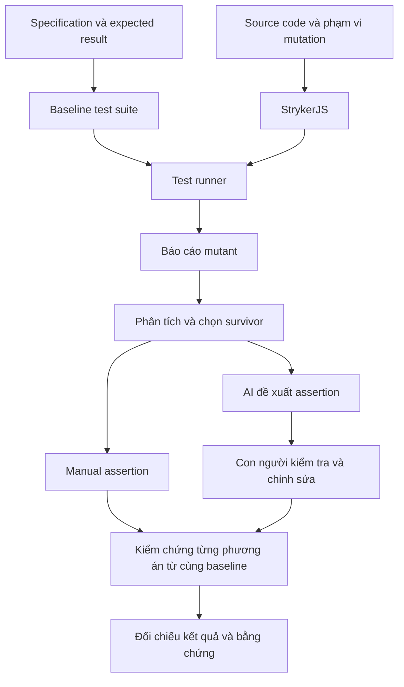

# SEMINAR REPORT

**ĐẠI HỌC QUỐC GIA THÀNH PHỐ HỒ CHÍ MINH**<br>
**TRƯỜNG ĐẠI HỌC KHOA HỌC TỰ NHIÊN**<br>
**KHOA CÔNG NGHỆ THÔNG TIN**

---

## Mutation Testing & Test Effectiveness

**Topic T10 - Nhóm 12**<br>
**Course:** Software Testing<br>
**Năm học:** 2026-2027

**Thành viên thực hiện**

- Lê Tấn Hiệp - 23129255
- Tống Dương Thái Hòa - 23120262
- Nguyễn Phúc Hoàng - 23120264

**Giảng viên hướng dẫn:** Dr. Lam Quang Vu, Dr. Tran Duy Hoang, MSc. Tran Thi Bich Hanh, MSc. Truong Phuoc Loc, MSc. Ho Tuan Thanh<br>
**Lớp học phần:** Software Testing - CQ2023/3

---

## Tóm tắt

Một test suite có thể thực thi đúng vùng source code nhưng vẫn bỏ sót hành vi sai nếu test data chưa phân biệt được các trường hợp hoặc assertions chỉ kiểm tra HTTP status. Mutation Testing đánh giá khả năng phát hiện sai khác bằng cách tạo những thay đổi nhỏ trong chương trình và quan sát phản ứng của tests. Trong seminar này, chúng em trình bày nền tảng Mutation Testing, khảo sát công cụ và thực hiện một case study trên EShop backend với ba domains: Cart & Orders, Coupons và Authentication & Users.

Thực nghiệm sử dụng StrykerJS kết hợp Jest và Supertest trên frozen baseline có 88 tests pass; 54 defect cases được chạy riêng. Kết quả được đối chiếu theo mutant signature trên cùng production source và mutation scope. Trong Cart & Orders, manual suite bổ sung 23 assertion kills so với baseline, còn AI-assisted suite bổ sung 13; cả hai cùng phát hiện 13 mutants. Trong Coupons, hai variants ban đầu cùng bổ sung 2 kills tại logic lưu usage limit. Các suites Coupons mở rộng lên 35 và 40 tests vẫn cho cùng mutation counts với variants trước. Authentication & Users đã có baseline và manual/reviewed-AI comparison: 60, 83 và 74 Killed; Timeout 27, RuntimeError 8 trong cả ba conditions. Các assertions dựa trên convention được công bố riêng. Một lần chạy chung ba domains trên 395 mutants cho mutation score 67,56% ở baseline, 80,53% ở manual và 75,47% ở reviewed AI. Kết quả Cart và Coupons được chạy lại chéo giữa các thành viên với 150/150 và 120/120 mutants khớp trạng thái.

Các quan sát cho thấy assertions về response data và database state giúp phát hiện sai khác mà status-only tests bỏ sót. Tuy nhiên, mutation score còn phụ thuộc Timeout, runtime errors và oracle; một mutant sửa được defect gốc không nên bị kill bằng expected result trái specification. Kết quả Coupons là comparison giữa các additions có AI hỗ trợ trong cùng context, không phải experiment độc lập giữa human và AI. Báo cáo vì vậy đưa ra kết luận mô tả trong phạm vi dữ liệu hiện có, đồng thời phân biệt runs do AI Agent thực thi với runs do thành viên tự chạy.

## Mục lục

- [1. Giới thiệu](#chuong-1)
- [2. Cơ sở lý thuyết và nghiên cứu liên quan](#chuong-2)
- [3. Khảo sát và lựa chọn công cụ](#chuong-3)
- [4. Đối tượng và thiết kế thực nghiệm](#chuong-4)
- [5. Triển khai và demonstration scenarios](#chuong-5)
- [6. Kết quả thực nghiệm](#chuong-6)
- [7. Thảo luận và giới hạn](#chuong-7)
- [8. Kết luận và hướng phát triển](#chuong-8)
- [References](#tai-lieu-tham-khao)
- [Appendix A. Reproduction procedure](#phu-luc-a)
- [Appendix B. Reusable AI prompt](#phu-luc-b)
- [Appendix C. Demo và activity design](#phu-luc-c)
- [Appendix D. Contributions và AI disclosure](#phu-luc-d)

## Abbreviations and terminology

| Term | Diễn giải trong báo cáo |
|---|---|
| AI / LLM | Artificial Intelligence / Large Language Model |
| API / HTTP / JWT | Application Programming Interface / Hypertext Transfer Protocol / JSON Web Token |
| SUT | System Under Test; trong seminar là EShop backend |
| RQ | Research Question |
| Baseline | Production source, configuration, fixtures và initial test suite được cố định để làm mốc comparison |
| Test oracle | Căn cứ xác định expected result của một test |
| Assertion | Điều kiện đối chiếu actual result với expected result |
| Mutation operator / mutator | Quy tắc biến đổi source code để sinh mutant |
| Mutant / survivor | Một program variant / mutant có trạng thái Survived trong run đang xét |
| Equivalent candidate | Mutant được nghi ngờ tương đương nhưng chưa đủ căn cứ kết luận |
| Fixture / test harness | Dữ liệu và trạng thái chuẩn bị cho tests / cơ chế nạp, cô lập và thực thi SUT |
| Run / rerun | Một lần thực thi có điều kiện và kết quả được lưu / lần thực thi lại |
| Mutant signature | Source file, location, mutator và replacement dùng để đối chiếu mutants giữa các reports |
| Assertion kill | Killed được truy về test failure; phân biệt với Timeout hoặc lỗi runner |
| Percentage point (pp) | Đơn vị chênh lệch tuyệt đối giữa hai tỷ lệ phần trăm |

<a id="chuong-1"></a>

## 1. Giới thiệu

### 1.1. Bối cảnh và vấn đề

Automated testing giúp kiểm tra hành vi phần mềm sau mỗi thay đổi. Tuy nhiên, việc toàn bộ tests trong suite đều pass chưa trả lời được test suite có đủ nhạy với các lỗi quan trọng hay không. Một nguyên nhân là test chỉ quan sát một phần kết quả: chẳng hạn xác nhận API trả về trường tổng tiền nhưng không kiểm tra giá trị tổng tiền theo quy tắc nghiệp vụ.

Code coverage cho biết các thành phần mã nào được thực thi. Thông tin này hỗ trợ tìm vùng chưa được kiểm tra, nhưng cần kết hợp với đánh giá dữ liệu đầu vào và assertion. Mutation Testing bổ sung một góc nhìn bằng cách đặt câu hỏi: khi hành vi của chương trình bị thay đổi, test suite có nhận biết được thay đổi đó hay không [1], [7].

### 1.2. Lý do lựa chọn seminar

Trong EShop, sai lệch nhỏ tại điều kiện biên hoặc phép tính có thể ảnh hưởng đến số tiền thanh toán, quyền truy cập hoặc trạng thái đơn hàng. Các trường hợp này phù hợp để phân tích quan hệ giữa yêu cầu nghiệp vụ, test data và khả năng phát hiện lỗi.

Sự xuất hiện của AI Agent tạo thêm một phương án xây dựng assertion. Câu hỏi cần kiểm chứng là assertion được đề xuất có dùng đúng expected result, chạy được trong môi trường thực tế và phát hiện đúng thay đổi mục tiêu hay không. Vì vậy, chúng em đặt việc kiểm tra đầu ra AI trong cùng quy trình thực nghiệm với manual assertion.

### 1.3. Mục tiêu

Seminar hướng đến bốn mục tiêu:

1. Giải thích nguyên lý Mutation Testing, cách đọc kết quả và giới hạn của mutation score.
2. Thiết lập quy trình áp dụng StrykerJS trên phạm vi EShop được lựa chọn.
3. Phân tích ít nhất ba surviving mutants, bổ sung ít nhất ba manual assertions và kiểm chứng assertions do AI đề xuất cho cùng các mutant [14].
4. Xây dựng tài liệu và bằng chứng đủ để người khác hiểu, thực hành và kiểm tra lại các kết luận.

### 1.4. Câu hỏi cần nghiên cứu

**RQ1.** Các mutant được lựa chọn sống sót vì thiếu dữ liệu phân biệt, thiếu quan sát kết quả hay nguyên nhân nào khác?

**RQ2.** Trên cùng baseline và cùng tập mutant mục tiêu, manual assertion và assertion có AI hỗ trợ sau review phát hiện được những thay đổi hành vi nào?

**RQ3.** Những mutant còn lại, sai sót của đầu ra AI và điều kiện thực thi giới hạn cách diễn giải kết quả ra sao?

**RQ4.** Những thông tin và bước kiểm chứng nào cần thiết để thành viên khác tái lập quy trình?

### 1.5. Đối tượng và phạm vi

Đối tượng nghiên cứu là test suite cho EShop backend trong ba miền: Cart & Orders, Coupons và Authentication & Users. Chúng em tập trung vào quan sát hành vi ở phạm vi được xác định từ API specification, dữ liệu đầu vào và kết quả lưu trữ liên quan. Phạm vi thực tế, endpoints và baseline được trình bày tại Chương 4; Chương 6 chỉ dùng completed runs có dữ liệu đối chiếu.

Thiết kế này đánh giá khả năng phát hiện các mutation được sinh trong phạm vi cấu hình. Việc suy rộng đến lỗi thực tế hoặc hệ thống khác cần thêm bằng chứng. AI Agent được nghiên cứu ở vai trò đề xuất assertion và hỗ trợ lập luận; sinh mutant bằng AI nằm ngoài phép so sánh chính. Agent và model thực tế được ghi riêng cho từng lần sử dụng.

### 1.6. Bố cục báo cáo

Chương 2 trình bày lý thuyết và các nghiên cứu liên quan. Chương 3 khảo sát, lựa chọn và giải thích vai trò công cụ. Chương 4 xác định thiết kế thực nghiệm; Chương 5 mô tả quy trình triển khai. Chương 6 dành cho kết quả, Chương 7 phân tích ý nghĩa và giới hạn, Chương 8 tổng kết seminar. Các appendices trình bày reproduction procedure, reusable AI prompt, activity design và contributions; danh mục evidence được quản lý riêng.

<a id="chuong-2"></a>

## 2. Cơ sở lý thuyết và nghiên cứu liên quan

### 2.1. Coverage, test oracle và assertion

Một test case gồm trạng thái ban đầu, dữ liệu hoặc thao tác kích hoạt hành vi, và điều kiện đánh giá kết quả. Test oracle cung cấp căn cứ cho điều kiện đánh giá đó. Trong seminar này, oracle xuất phát từ yêu cầu nghiệp vụ đã được làm rõ; source code hiện tại là đối tượng đối chiếu, không tự động trở thành định nghĩa hành vi đúng.

Chẳng hạn, một test xác nhận phản hồi có thuộc tính `discount` mới chỉ kiểm tra sự hiện diện của dữ liệu. Để đánh giá phép tính, cần xác định expected value, đơn vị, quy tắc làm tròn và các điều kiện áp dụng. Một assertion đúng cú pháp nhưng sử dụng expected value sai vẫn có thể làm giảm giá trị của test suite.

Trong báo cáo, code coverage và mutation score được trình bày như những thông tin bổ sung cho nhau. Việc bổ sung dữ liệu đầu vào có thể thay đổi coverage; việc thay đổi assertion có thể nâng khả năng phát hiện sai lệch ngay cả khi tập dòng mã được thực thi không đổi.

### 2.2. Khái niệm và quy trình Mutation Testing

Mutation Testing tạo các biến thể của chương trình bằng những phép thay đổi được quy định trước, rồi dùng test suite để đánh giá chúng. Một mutant bị phát hiện khi test nhận biết được sai khác do biến thể gây ra. Công trình tổng quan của Jia và Harman hệ thống hóa nền tảng và các hướng phát triển của phương pháp này [1].

Quy trình khái quát gồm: xác nhận test suite chạy trên original program; sinh mutant trong phạm vi đã chọn; thực thi tests với mutant; tổng hợp trạng thái; phân tích nguyên nhân và cải thiện testing. Khi đọc kết quả, cần kiểm tra cả vị trí mutation lẫn điều kiện đã sử dụng để chạy tests.

### 2.3. Mutation operators

Mutation operator mô tả một loại biến đổi; mutant là một lần áp dụng cụ thể của mutator tại một vị trí. Các nhóm dưới đây minh họa những biến đổi trong danh mục mutator của Stryker [3].

**Bảng 2.1. Nhóm mutation và hướng thiết kế quan sát.**

| Nhóm | Ví dụ biến đổi | Quan sát có thể phân biệt |
|---|---|---|
| Số học | `a - b` thành `a + b` | Giá trị tính toán |
| So sánh | `a >= b` thành `a > b` | Trường hợp bằng ngưỡng |
| Logic | `a && b` thành `a \|\| b` | Một điều kiện đúng, điều kiện còn lại sai |
| Boolean | `true` thành `false` | Nhánh hành vi được kích hoạt |
| Khối lệnh | Thay thân khối bằng khối rỗng | Tác động hoặc dữ liệu bắt buộc |
| Chuỗi / tập hợp | Thay nội dung bằng giá trị rỗng | Nội dung phản hồi hoặc phần tử cần tồn tại |

Bảng trên dùng để giải thích cách thiết kế tests. Danh sách mutant thực tế của EShop phải được lấy từ báo cáo của lần chạy tương ứng.

### 2.4. Điều kiện phát hiện thay đổi hành vi

Trong quá trình phân tích, tụi em sử dụng ba câu hỏi: test có đi đến vị trí bị thay đổi không; dữ liệu có làm original program và mutant tạo ra trạng thái khác nhau không; assertion có quan sát được sai khác đó không. Cách phân tích này giúp chuyển một survivor thành vấn đề cụ thể cần giải quyết.

Xét ví dụ minh họa độc lập với EShop: đơn hàng đủ điều kiện khi giá trị đạt tối thiểu 500 đơn vị. Hàm gốc và một mutant giả định là:

```javascript
// Ví dụ lý thuyết, không phải mã hoặc kết quả thực nghiệm EShop.
function eligible(amount) {
  return amount >= 500;
}

// Mutant giả định: return amount > 500;
```

**Bảng 2.2. Dữ liệu phân biệt tại biên của ví dụ.**

| Đầu vào | Kết quả theo quy tắc | Original program | Mutant giả định |
|---|---|---|---|
| 499 | `false` | `false` | `false` |
| 500 | `true` | `true` | `false` |
| 501 | `true` | `true` | `true` |

Nếu chỉ dùng 499 và 501, test không phân biệt hai phiên bản. Với đầu vào 500, assertion kiểm tra chính xác kết quả `true` nhận biết được thay đổi. Nếu chỉ kiểm tra kiểu dữ liệu Boolean, đầu vào đúng biên vẫn chưa đủ. Các giá trị trong bảng được suy ra trực tiếp từ hai biểu thức; chúng không phải số liệu của một lần chạy công cụ.

### 2.5. Trạng thái mutant và mutation score

Các trạng thái và công thức dưới đây theo tài liệu Stryker [2].

**Bảng 2.3. Các trạng thái cần đọc trong mutation report.**

| Trạng thái | Ý nghĩa |
|---|---|
| `Killed` | Có ít nhất một test fail khi mutant hoạt động |
| `Survived` | Các tests được chạy đều thành công |
| `NoCoverage` | Không có test coverage tại mutant |
| `Timeout` | Thực thi vượt giới hạn thời gian |
| `RuntimeError` / `CompileError` | Lỗi thực thi công cụ hoặc biên dịch |
| `Ignored` | Được bỏ qua |
| `Pending` | Chưa có kết quả thực thi cuối |

Đặt `K`, `T`, `S`, `N` lần lượt là số `Killed`, `Timeout`, `Survived`, `NoCoverage`. Công thức mutation score của Stryker là:

```text
V = K + T + S + N
Mutation score (%) = 100 × (K + T) / V, với V > 0
```

Các trạng thái lỗi, bỏ qua và chưa chạy được báo riêng. Khi `V = 0`, cần giữ cách biểu diễn của công cụ và giải thích rõ.

Trong phép so sánh của nhóm, số mutant chuyển sang `Killed` được đối chiếu thêm với detecting test. `Timeout` không được dùng làm bằng chứng rằng assertion đã quan sát đúng sai khác nghiệp vụ.

### 2.6. Equivalent mutants

Equivalent mutant giữ nguyên hành vi quan sát được so với original program trong miền đầu vào đang xét. Vì vậy, một survivor có thể phản ánh sự tương đương thay vì thiếu tests. Stryker minh họa rằng một thay đổi điều kiện có thể không làm thay đổi kết quả cuối cùng [4].

Chúng em sử dụng nhãn *equivalent candidate* khi chưa đủ căn cứ kết luận. Việc phân tích cần nêu miền dữ liệu hợp lệ, trạng thái có thể đạt tới và những đầu ra hoặc tác động được quan sát. Thử một số đầu vào và không tìm thấy khác biệt chỉ là bằng chứng trong các trường hợp đã thử. Giải thích do AI tạo ra cũng cần được kiểm tra theo cùng tiêu chí.

### 2.7. Vai trò của AI trong Mutation Testing

Cần phân biệt ba nhiệm vụ: sinh assertion hoặc test; hỗ trợ nhận diện equivalent mutants; và sinh mutant. Trong thiết kế này, nhiệm vụ chính là đề xuất assertion từ specification, source code, baseline tests và mutant mục tiêu. Đầu ra được đánh giá là test candidate cùng khả năng phát hiện mutant sau verification; người review của từng domain được ghi trong Bảng 6.4.

Chúng em phân biệt đầu ra AI nguyên gốc với phiên bản được sửa trước khi chạy. Nếu con người phải thay oracle hoặc viết lại phần kiểm tra chính, thông tin đó cần xuất hiện trong kết quả. Khi đó, hiệu quả đo được thuộc quy trình có AI hỗ trợ và con người kiểm chứng; mức đóng góp của bản đề xuất nguyên gốc được mô tả riêng.

### 2.8. Nghiên cứu liên quan

**Bảng 2.4. Các nguồn nghiên cứu và liên hệ với seminar.**

| Nghiên cứu | Nội dung được sử dụng | Liên hệ với thiết kế của nhóm |
|---|---|---|
| Jia và Harman [1] | Tổng quan nền tảng và phát triển của Mutation Testing | Đặt khái niệm, mutator và vấn đề tương đương trong bối cảnh nghiên cứu |
| Petrović và Ivanković [9] | Phân tích mutation theo thay đổi mã và lựa chọn vị trí có ích tại Google | Ghi rõ phạm vi lựa chọn và các loại trừ để diễn giải đúng kết quả |
| Wang và cộng sự [10] | MUTGEN sử dụng phản hồi mutation trong quá trình sinh unit test bằng LLM | Đưa mutant cụ thể vào đầu vào AI và kiểm chứng kết quả thực thi |
| Tian và cộng sự [11] | Đánh giá LLM cho nhận diện equivalent mutants | Xem nhận định của model là đối tượng cần đánh giá |

Các công trình trên cung cấp nền tảng và hướng tiếp cận. Nghiên cứu EShop có phạm vi, ngôn ngữ, dữ liệu và điều kiện sử dụng AI riêng; kết quả từ công trình khác không được chuyển thành kết quả của nhóm. Phần tổng hợp [9]-[11] sử dụng thông tin mô tả phương pháp trên trang công bố; báo cáo không thực hiện tái lập các nghiên cứu đó.

<a id="chuong-3"></a>

## 3. Khảo sát và lựa chọn công cụ

### 3.1. Tiêu chí đánh giá

Chúng em xem xét công cụ theo năm tiêu chí: chi phí và điều kiện sử dụng; yêu cầu kiến thức khi tiếp cận; mức phù hợp với EShop; vai trò hỗ trợ AI; tài liệu và cộng đồng hỗ trợ. Phép so sánh cần phân biệt khả năng được tài liệu công cụ mô tả với khả năng đã được kiểm chứng trên hệ thống cụ thể.

Đối với seminar này, tính phù hợp với ngôn ngữ backend và khả năng truy vết kết quả là hai điều kiện quan trọng. Các nhận xét về tốc độ, mức dễ học hoặc chi phí sử dụng thực tế cần gắn với môi trường, phiên bản và tài khoản đã dùng. Thời gian làm quen chưa được đo không được trình bày như số liệu thực nghiệm.

### 3.2. Các công cụ truyền thống

**Bảng 3.1. Đối chiếu các ứng viên theo hệ sinh thái.**

| Công cụ | Hệ sinh thái | Vai trò trong khảo sát | Đánh giá đối với EShop backend |
|---|---|---|---|
| StrykerJS [5] | JavaScript / TypeScript, gồm Node.js | Ứng viên thực thi mutation chính | Phù hợp về ngôn ngữ; cần tích hợp với test suite |
| PIT [7] | Java / JVM | Công cụ đối chiếu trong hệ sinh thái khác | Không trực tiếp thực thi trên backend JavaScript |
| mutmut [8] | Python | Công cụ đối chiếu và hướng lựa chọn khi SUT dùng Python | Không trực tiếp thay StrykerJS trên SUT hiện tại |

Phạm vi này kế thừa khảo sát công cụ của nhóm, đồng thời tập trung vào những đặc điểm ảnh hưởng đến lựa chọn cho EShop. Việc PIT hoặc mutmut không phù hợp trực tiếp về ngôn ngữ không phải đánh giá chất lượng tổng quát của các công cụ đó.

### 3.3. Hướng hỗ trợ bằng AI

Một AI Agent có thể tiếp nhận ngữ cảnh specification, source code và mutant để đề xuất tests. Giao diện sử dụng, model, quyền truy cập tệp và khả năng gọi lệnh phụ thuộc sản phẩm cụ thể. Vì vậy, báo cáo dùng tên vai trò chung trong thiết kế, còn hồ sơ từng lần sử dụng ghi đúng agent và model thực tế.

Các hướng hỗ trợ được phân biệt theo đầu ra: đề xuất test data, viết assertion, giải thích nguyên nhân survivor hoặc đưa ra giả thuyết về tính tương đương. Chỉ các assertion được đưa qua quy trình kiểm chứng mới tham gia phép so sánh thực nghiệm chính.

**Bảng 3.2. Các ứng viên và hướng tiếp cận có AI hỗ trợ đã khảo sát.**

| Ứng viên / hướng | Chức năng và cách tích hợp | Chi phí / điều kiện sử dụng | Đánh giá đối với seminar |
|---|---|---|---|
| Chat LLM + Stryker report [23] | Claude hoặc ChatGPT nhận specification, code, tests và mutant; đề xuất assertion candidates để chạy lại | Dịch vụ của nhà cung cấp, có gói miễn phí giới hạn [27] | Phù hợp bài toán sinh assertion; chọn Claude, giữ ChatGPT làm ứng viên dự phòng |
| Coding agent + Stryker | Agent đọc code/report, sửa tests và gọi mutation engine | Chi phí và quyền truy cập phụ thuộc sản phẩm cụ thể | Hướng tự động hóa workflow; cần kiểm soát lệnh đã chạy và truy nguyên kết quả |
| stryker-llm-mutator [26] | Bổ sung mutants bằng heuristic hoặc LLM qua extension cho Stryker | Tác giả mô tả là bản vá không chính thức; LLM mode phụ thuộc provider | Thay đổi tập mutants nên không dùng cho phép so sánh assertion |
| Mutahunter [24] | Sinh mutant bằng LLM và chạy test command của project; cần Python 3.11+ | AGPL-3.0; cần API/model | Hướng nghiên cứu sinh mutant; tích hợp EShop cần proof of concept riêng |
| LLMorpheus [25] | Sinh mutant cho npm JS/TS, chạy qua StrykerJS đã sửa đổi | MIT; cần LLM API và bản Stryker tùy biến; là research prototype | Gần EShop về ngôn ngữ nhưng chuyển câu hỏi sang chất lượng mutants |

Sinh assertions trên cùng tập mutants và sinh thêm mutants để đánh giá tests là hai bài toán khác nhau. Nếu đổi tập mutants khi so sánh manual và AI assertions, mutation score không còn phản ánh riêng tác động của assertions. Vì vậy, các công cụ sinh mutant được giữ ở mức khảo sát, không đưa vào bộ triển khai.

### 3.4. Ma trận đánh giá và lý do lựa chọn

**Bảng 3.3. Tiêu chí áp dụng cho hai vai trò được lựa chọn.**

| Tiêu chí | StrykerJS | AI Agent |
|---|---|---|
| Chi phí / điều kiện sử dụng | Stryker core 10.0.0 có license Apache-2.0 theo package metadata; execution dùng local runtime | Dùng Claude Code và Codex theo actual run records; chưa đo hoặc tổng hợp chi phí tài khoản |
| Kiến thức cần có | Tests, runner, cấu hình và đọc mutation report | Specification, thiết kế prompt và kiểm tra mã được đề xuất |
| Phù hợp với EShop | Hỗ trợ hệ sinh thái JavaScript / Node.js [5] | Đánh giá qua tính đúng và khả năng chạy của từng candidate |
| Vai trò AI | Cung cấp phản hồi thực thi cho quy trình | Đề xuất assertion và giải thích |
| Tài liệu / hỗ trợ | Official documentation về configuration, runners và reports [6], [12], [13] | Generation được kiểm tra bằng specification và actual test/mutation results; không lấy model output làm nguồn xác nhận correctness |

Lựa chọn StrykerJS và AI Agent dựa trên ba lý do: công cụ thực thi phù hợp với backend JavaScript; kết quả mutation tạo căn cứ cụ thể để cải thiện testing; và quy trình cho phép đối chiếu đề xuất AI với phương án manual trên cùng mục tiêu. Agent/model và điều kiện comparison thực tế được công bố tại mục 4.5 và 6.4.

### 3.5. Chức năng và kiến trúc StrykerJS

StrykerJS là công cụ Mutation Testing cho các dự án JavaScript và TypeScript [5]. Trong luồng tích hợp, phần lõi phối hợp tạo mutation và thực thi, test runner chạy test suite, còn reporter trình bày kết quả. Stryker cung cấp các plugin runner và reporter; một số plugin được cài dưới dạng gói riêng [12].

**Hình 3.1. Luồng xử lý khái quát của thực nghiệm.**



Hình 3.1 mô tả workflow áp dụng cho EShop. Kết quả thực thi của từng bước được trình bày tại Chương 6; kết quả chạy lại chéo giữa các thành viên ở mục 6.7.

### 3.6. Đầu vào, đầu ra và giới hạn của AI Agent

Đầu vào AI cần chứa phần specification liên quan, source code trong phạm vi, baseline tests, mutant mục tiêu và yêu cầu đầu ra. Candidate phải sử dụng API hoặc helper có thật, chuẩn bị dữ liệu hợp lệ và kiểm tra kết quả có căn cứ.

Đầu ra được lưu trước khi chỉnh sửa để bảo toàn quá trình đánh giá. Các thay đổi của người thực hiện phải chỉ rõ là sửa cú pháp, fixture, cách gọi API hay logic assertion. Việc một agent có thể gọi lệnh không thay thế yêu cầu kiểm tra lệnh đã chạy, trạng thái nguồn và báo cáo thực tế.

### 3.7. Mức tự động hóa

Quy trình được thiết kế theo hướng bán tự động: công cụ thực hiện phần chạy tests và tổng hợp trạng thái; con người xác định oracle, lựa chọn phạm vi, kiểm tra candidate và diễn giải survivor. Khả năng tái sử dụng nằm ở cấu hình được lưu, mẫu đầu vào AI và quy trình xác minh thống nhất. Mỗi lần áp dụng cho nghiệp vụ mới vẫn cần thay dữ liệu và expected result theo specification.

<a id="chuong-4"></a>

## 4. Đối tượng và thiết kế thực nghiệm

### 4.1. Kiến trúc EShop và phạm vi quan sát

EShop là SUT phục vụ seminar, gồm backend JavaScript chạy trên Node.js, HTTP routes dùng Express và persistence dùng SQLite [15], [16], [18]. Backend xử lý authentication, profile, cart, orders và coupons. Authentication dựa trên JWT; một số hành vi còn phụ thuộc in-memory cart state, database state hoặc thời gian hiện tại. Vì vậy, quan sát HTTP status chưa đủ để đánh giá toàn bộ business outcome.

Test architecture gồm Jest để tổ chức test cases và lifecycle hooks; Supertest để gửi requests tới Express app; SQLite test database để quan sát persistence; StrykerJS để sinh và thực thi mutants. Tests kiểm tra response body và database state khi specification yêu cầu một thay đổi có thể quan sát được.

Phạm vi này là backend/API testing. Không có kết luận về browser rendering, mobile UI, usability hoặc end-to-end behavior của toàn bộ frontend. Một API flow gồm nhiều HTTP calls cũng không tự chứng minh các calls tạo thành atomic transaction.

### 4.2. Domains và mutation scope

**Bảng 4.1. Phạm vi thực nghiệm tại frozen baseline.**

| Domain | API và hành vi chính | Business references | Mutation scope trong source |
|---|---|---|---|
| Cart & Orders | Đọc/thêm cart items; checkout; order history/detail; cancel và admin status update | FR-07, FR-08, FR-10, FR-11; API-4 và 6.2 | Hai vùng của server: lines 280-349 và 510-568 |
| Coupons | Quote coupon; minimum amount, expiry, discount type, per-user usage; admin create/list/delete; explicit usage recording | FR-09, FR-12, FR-17; API-5 và 6.4 | Server lines 355-492 |
| Authentication & Users | Login attempts/lock, registration, OTP/reset password, profile và access-related behavior | API-1 và 2; SEC-01, SEC-02, SEC-06, SEC-07 | Server lines 20-135 |

Các line ranges mô tả đúng frozen revision, không áp dụng mặc nhiên cho source đã chỉnh sửa. Mỗi domain có test selection và mutant universe riêng. Các mutation reports được báo theo domain. Lần thực thi chung bổ sung ba runs, mỗi run chọn hợp các line ranges và chạy cả ba domains trong hai Jest projects. Kết quả S4 được trình bày riêng tại mục 6.8.

### 4.3. Test oracle, original defects và assumptions

Tụi em lấy specification làm căn cứ cho expected business behavior, đối chiếu với API contract và implementation [15], [18]. Khi specification chưa quy định exact HTTP code hoặc error text, báo cáo phân biệt API convention với business requirement. Assertions về literal message có thể kiểm tra compatibility của implementation nhưng không được tự xem là một business rule độc lập.

Production source được giữ nguyên để cố định đối tượng đo. Tests đúng specification nhưng fail trên original code được tách khỏi passing baseline và chạy trong defect profile. Cách làm này duy trì baseline hợp lệ cho mutation execution, đồng thời công bố các hành vi chưa được đánh giá bằng original-code-passing tests.

**Bảng 4.2. Original defects và assumptions ảnh hưởng phép đo.**

| Domain | Quan sát từ source/tests | Cách xử lý và giới hạn |
|---|---|---|
| Cart & Orders | Duplicate cart items; checkout tin total từ client; cart chưa được clear; sai cancel/status rules; thiếu một số access/ownership checks | 9 defect cases chạy riêng; không đổi expected result để coi behavior sai là đúng |
| Coupons | Sai minimum equality, expiry equality và percentage formula; thiếu JWT/role/input validation ở một số routes | 22 defect cases chạy riêng; passing baseline tập trung scenarios còn có oracle hợp lệ |
| Authentication & Users | Login lock/count, registration, OTP và profile validation/access còn sai khác specification | 23 defect cases chạy riêng; từng oracle vẫn cần xét căn cứ |
| OTP duration | Specification yêu cầu OTP có expiry nhưng không ấn định TTL bằng 24 giờ | Test dùng mốc 24 giờ được ghi là assumption, không phải contractual duration |
| Coupon edge policies | Rounding, normalization, negative final amount, duplicate status và atomic usage chưa được specification xác định đủ | Không tự bổ sung business rule để tăng kill count |

Tổng cộng 54 defect cases fail tại assertions trong profile riêng, không phải suite failures do import hoặc setup [19]. Con số này là số test cases, không phải 54 defects độc lập; parameterized tests có thể cùng kiểm tra một defect hoặc assumption.

Một counterfactual check trên bản sao tạm đã sửa minimum comparator, expiry comparator và percentage calculations: ba selected defect cases chuyển từ fail sang pass, trong khi 26 Coupons baseline tests vẫn pass. Check này hỗ trợ ba oracle cụ thể; nó không thay đổi production baseline và không xác nhận toàn bộ defect catalog.

### 4.4. Comparison conditions và AI provenance

**Bảng 4.3. Ba test conditions và nguồn gốc thực tế.**

| Condition | Thành phần | Cách diễn giải |
|---|---|---|
| Baseline | Initial tests đã freeze, pass trên original code | Mốc đối chiếu của từng domain |
| Cart manual | Baseline 36 tests cùng 8 manual tests | Human-authored suite, được chạy lại trên frozen input |
| Cart AI-assisted | Baseline 36 tests cùng 5 tests | Đã qua spec review, giữ nguyên 5/5 assertions; generation có partial-blind limitation |
| Coupons manual-analysis draft | Baseline 26 tests cùng 3 cases | AI-assisted spec-analysis draft; không gán thành independent human manual work |
| Coupons AI candidate | Baseline 26 tests cùng 2 parameterized cases | Cùng context với manual-analysis; không phải blind comparison |
| Auth manual / AI | Baseline cùng 13 manual tests hoặc 11 reviewed-AI tests | Có spec/convention/interpretation labels; rejected test.failing không tham gia |

Các conditions cùng dùng production source, mutation ranges và execution policy. Tuy nhiên, số tests và breadth của additions khác nhau: Cart manual có thêm scenarios ngoài selected targets; Coupons variants chia sẻ context và, ở extension, dùng chung scenario helpers. Vì vậy, đây là descriptive comparison của các test suites cụ thể, không phải controlled experiment đo riêng tác động của "con người" hoặc một model.

### 4.5. Survivor selection và unit of analysis

Unit of analysis chính là mutant trên một production revision và configuration xác định. Một target cần có location, mutator, replacement, baseline status và oracle phân biệt được original với mutant. Khi original code đã sai specification tại vị trí đó, chúng em phân loại riêng thay vì tạo assertion củng cố defect.

Yêu cầu seminar gồm phân tích ít nhất ba survivors và bổ sung ít nhất ba manual assertions [14]. Chương 6 trình bày ba Cart cases ở các locations khác nhau và một Coupons case với hai mutants cùng root cause. Hai mutants cùng usage-limit expression không được diễn giải thành hai business defects khác nhau.

Numeric mutant ID chỉ có ý nghĩa trong report tương ứng. Comparison giữa các runs dùng mutant signature; không so sánh bằng ID đơn lẻ nếu source, locations hoặc mutant ordering đã đổi.

### 4.6. Metrics và nguyên tắc đối chiếu

Các metrics chính gồm status counts, mutation score theo Stryker, số Survived -> Killed, test count và mapping từ mutant sang detecting test. Ký hiệu K, T, S, N lần lượt là Killed, Timeout, Survived, NoCoverage; valid population V = K + T + S + N [2].

Để nhìn riêng test failures, báo cáo bổ sung tỷ lệ K/V và gọi rõ là **assertion-kill proportion**, không thay tên hoặc định nghĩa official mutation score. Killed vẫn cần đọc failure reason; một status riêng lẻ không chứng minh assertion phản ánh đúng specification.

Coverage được báo cùng scope đo. Execution duration không được sử dụng để kết luận productivity của thành viên, vì chưa có protocol đo effort hoặc repeated runs phục vụ comparison đó. Không cộng hay lấy trung bình domain scores để tạo một "overall score".

### 4.7. Data collection và reproduction

Statistics trong báo cáo được tổng hợp lại từ completed JSON reports, test results và command metadata [19], [20]. Mutants được đối chiếu theo source/location/mutator/replacement; test counts được lấy từ test execution results. Raw logs, source snapshots, hashes và artifact locations thuộc hồ sơ evidence riêng, không được lặp thành danh mục paths trong report.

Mỗi run được ghi rõ executor: thành viên tự chạy hoặc AI Agent thực thi. Run do Agent thực thi chứng minh workflow chạy được trong environment được ghi nhận; kết quả chạy lại chéo giữa các thành viên được trình bày tại mục 6.7.

<a id="chuong-5"></a>

## 5. Triển khai và demonstration scenarios

### 5.1. Integration của test harness

Backend ban đầu khởi động server và database tại module load, nên tests cần kiểm soát lifecycle và state. Cart/Coupons harness nạp Express app qua wrapper/mocks, dùng SQLite in-memory và reset dữ liệu; Auth giữ harness riêng. Jest project isolation ngăn mocks/listen spies ảnh hưởng nhau.

Integration giữ nguyên năm Auth source files gốc và đối chiếu SHA-256; các chỉnh sửa phục vụ configuration/cleanup được quản lý riêng. Phân biệt này giúp tránh nhầm kết quả của adapted assertions với kết quả nguyên bản của tác giả domain.

### 5.2. Fixtures, state reset và clock control

Cart cần fresh user/cart state để các cases không phụ thuộc lịch sử requests. Coupons reset coupons và usage records, tạo JWT cho test user, rồi kiểm tra state trước/sau API calls. Auth reset users theo test và cô lập database mocks.

Coupons chỉ fake Date, giữ timers khác hoạt động bình thường; cleanup khôi phục real timers và đóng database connections. Với expiry scenarios, clock được cố định và token có thể được tạo lại sau khi đổi thời điểm. Cơ chế này giảm nguy cơ kết quả thay đổi vì wall clock hoặc token expiry thay vì logic đang xét.

Một Coupons API flow thực hiện quote -> checkout -> explicit usage recording -> quote lại. Tests kiểm tra usage chưa được ghi trước explicit call và limit được áp dụng sau call. Flow này không chứng minh checkout tự ghi usage, không chứng minh cart clearing hoặc atomicity giữa endpoints.

### 5.3. Baseline execution và scope control

Trước mutation execution, nhóm chạy original tests để xác nhận đúng test selection và environment. Final frozen input có 88 passing tests, được kiểm tra thêm với randomized order seeds 421023 và 731023. Defect profile được chạy riêng và kết quả fail có chủ đích được diễn giải theo oracle của từng case.

Stryker dry runs nhận 36 Cart tests, 26 Coupons tests và 26 Auth tests. Sau đó full mutation runs được thực hiện theo domain. Shared timeout/concurrency policy giữ cố định; reports được lưu riêng cho baseline và variants.

Trên Windows, sandbox folder dùng tên stryker-tmp. Integration evidence ghi nhận tên có dấu chấm ở đầu từng làm Jest không discover tests. Đây là environment-specific observation; không diễn giải thành quy tắc chung cho mọi version hoặc operating system.

### 5.4. Manual assertion design

Survivor analysis đi từ specification đến observation: xác định state/input, xem original và replacement khác nhau ở đâu, rồi chọn assertion kiểm tra response data hoặc persistence. Test thêm chỉ có ý nghĩa khi nó pass trên original và fail do intended difference trên mutant.

Ví dụ Cart: POST trả 200 không bảo đảm item đã được lưu; sau khi thêm hai distinct items, GET phải trả lại đúng cả hai. Ví dụ Coupons: input usage limit bằng 1 không phân biệt original expression với mutant luôn lưu 1; dùng limit 3 và đọc lại persisted value tạo observation có khả năng phân biệt.

Assertion count, test-case count và kill count được báo riêng. Nhiều assertions trong cùng scenario có thể chỉ làm lộ một root cause; nhiều mutants bị kill có thể thuộc cùng expression hoặc cùng implementation convention.

### 5.5. AI candidate generation và review

AI input gồm relevant specification, original source, baseline tests/helpers, mutant diff và runner/reset constraints. Reusable prompt ở Appendix B yêu cầu giải thích oracle và không khẳng định đã execution khi chưa có run. Đây là prompt pattern, không phải transcript giả lập của một run.

Review kiểm tra oracle, helper/API compatibility, fixtures và failure behavior. Candidate được phân loại accepted, edited hoặc rejected; raw output và executed version được giữ riêng khi có chỉnh sửa.

Cart record ghi 5 generated tests được giữ nguyên assertions; chỉnh sửa sau đó chỉ liên quan header comments. Coupons initial AI candidate có raw/executed hashes khớp và được Agent review chấp nhận. Không suy ra chất lượng nguyên gốc của candidate từ kết quả của bản đã sửa.

### 5.6. Mutation verification và diagnosis

Comparison dùng cùng source bytes và mutant signatures. Khi status đổi, chúng em xem detecting test và failure reason; khi score đổi mà Killed không đổi, cần kiểm tra Timeout và valid denominator trước khi kết luận test effectiveness tăng.

Trong Cart frozen reruns, cả 150 mutant signatures khớp giữa conditions. Coupons initial comparison có 120 signatures khớp và chỉ hai mutants chuyển Survived -> Killed. Auth provisional/frozen comparison có 125 signatures khớp nhưng một số RuntimeError chuyển sang Timeout; trường hợp này được phân tích riêng tại Chương 7.

### 5.7. Demonstration scenarios

**Bảng 5.1. Nội dung demonstration và điều kiện quan sát.**

| Tool / mức | Nội dung demonstration | Checkpoint cụ thể |
|---|---|---|
| StrykerJS / setup | Xác nhận versions, test discovery và passing baseline | Đúng domain test set; không vô tình chạy defect suite |
| StrykerJS / basic | Chạy mutation và mở survivor diff | Xác định location, replacement, status và scope |
| StrykerJS / advanced | Bổ sung assertion rồi đối chiếu mutant signature | Original pass; selected mutant chuyển sang Killed; đọc detecting test |
| AI Agent / setup | Chuẩn bị quyền truy cập và context | Ghi đúng agent/model và actual inputs |
| AI Agent / basic | Đề xuất assertion từ survivor và specification | Oracle có căn cứ; dùng đúng API/helpers |
| AI Agent / advanced | Review candidate, kiểm chứng và phân tích limitations | Phân biệt raw/final output, actual kills và provenance |

Execution evidence đã có cho các workflows tương ứng. Video demonstration của nhóm: [https://youtu.be/tVNW5gYQSiM](https://youtu.be/tVNW5gYQSiM).

### 5.8. Data-driven testing và reusable workflow

Data-driven testing dùng cùng test structure với nhiều input/expected pairs. Coupons initial AI suite kiểm tra limits 2 và 4; extension dùng parameterized minimum và expiry scenarios. Mỗi row vẫn cần oracle riêng; tăng số rows không tự bảo đảm có thêm relevant mutants.

Checkpoints là assertions tại response, stored data hoặc state transition. Workflow tái sử dụng qua fixtures, configuration và prompt pattern; mỗi domain mới vẫn cần specification và mutant analysis riêng. Record & Playback không được triển khai như GUI recording; rerun script hoặc mở HTML report không được gọi là GUI playback.

<a id="chuong-6"></a>

## 6. Kết quả thực nghiệm

### 6.1. Baseline tests và mutation results

**Bảng 6.1. Passing baseline và separate defect profile.**

| Domain | Baseline tests pass | Defect cases fail riêng | Ghi chú |
|---|---:|---:|---|
| Cart & Orders | 36 | 9 | Initial suite chủ yếu quan sát HTTP status |
| Coupons | 26 | 22 | 25 cases cùng 1 explicit API flow |
| Authentication & Users | 26 | 23 | Có OTP-duration assumption trong defect profile |
| Integration test run | **88** | **54** | Test counts; không phải số business defects hoặc combined mutation score |

Whole-server coverage của integration run là statements 68,70%; branches 59,68%; functions 61,42%; lines 71,84%. Đây là coverage của toàn server trong run được ghi nhận, không phải coverage riêng của từng mutation domain và không phải chứng cứ mọi covered behavior đã được assert.

**Bảng 6.2. Frozen mutation baseline theo domain.**

| Domain | Total | Killed | Timeout | Survived | NoCoverage | RuntimeError | Valid V | Score |
|---|---:|---:|---:|---:|---:|---:|---:|---:|
| Cart & Orders | 150 | 82 | 25 | 34 | 2 | 7 | 143 | 74,83% |
| Coupons | 120 | 39 | 21 | 30 | 25 | 5 | 115 | 52,17% |
| Authentication & Users | 125 | 60 | 27 | 23 | 7 | 8 | 117 | 74,36% |

CompileError, Ignored và Pending bằng 0 trong ba reports trên. RuntimeError được báo ngoài valid population. Mỗi row có source scope và test selection riêng; báo cáo không tạo overall score bằng cách gộp ba rows [19].

### 6.2. Phân tích selected survivors

Các mutant diffs dưới đây lấy từ frozen reports. Assertion snippets được trích lược từ executed tests để làm rõ observation; một số tên biến được rút gọn cho dễ đọc. Numeric IDs thuộc frozen domain report tương ứng.

#### 6.2.1. Cart khởi tạo sai nội dung nhưng vẫn trả HTTP 200

Frozen mutant 6 tại server line 286 dùng ArrayDeclaration để thay empty array bằng array chứa một phần tử do Stryker chèn [17]:

~~~javascript
// Original
userCarts[userId] = [];

// Mutant
userCarts[userId] = ["Stryker was here"];
~~~

Status-only test không quan sát cart contents nên baseline vẫn pass. Với fresh user chưa có cart, manual và AI tests đọc cart rồi yêu cầu empty array:

~~~javascript
expect(response.status).toBe(200);
expect(response.body).toEqual([]);
~~~

Empty cart là interpretation của cart contract được nhóm sử dụng, không phải exact JSON shape được API text mô tả đầy đủ. Giới hạn oracle này được giữ rõ. Trong frozen reports, mutant chuyển **Survived -> Killed ở cả manual và AI**.

#### 6.2.2. Cart không lưu item nhưng request vẫn thành công

Frozen mutant 15 tại server line 293 dùng CallExpression để xóa tác động thêm item:

~~~javascript
// Original
userCarts[userId].push(req.body);

// Mutant: call bị thay bằng empty statement
;
~~~

Theo FR-07, thao tác thêm sản phẩm phải làm item xuất hiện trong cart. Test tạo hai distinct items, POST từng item và GET lại cart; detecting assertions quan sát danh sách và nội dung trả về:

~~~javascript
expect(cart.body).toHaveLength(2);
expect(cart.body[0]).toEqual(item1);
expect(cart.body[1]).toEqual(item2);
~~~

Đây cũng là test bắt được một mutant khác luôn reset cart trước mỗi POST. Trong selected frozen mutant 15, status-only baseline bỏ sót tác động bị mất; **manual và AI cùng chuyển mutant sang Killed**.

#### 6.2.3. Cancel trả thành công nhưng persisted status sai

Frozen mutant 68 tại server line 335 dùng StringLiteral để thay giá trị "canceled" bằng empty string trong database update. HTTP success có thể không đổi trong khi stored state đã sai.

Oracle từ FR-10 yêu cầu pending order được cancel chuyển sang canceled. Manual test cancel order, đọc database bằng helper và kiểm tra:

~~~javascript
expect(cancelResponse.status).toBe(200);
expect(await orderStatus(db, orderId)).toBe("canceled");
~~~

Original-code manual suite pass. Mutant này **Survived ở baseline, Killed ở manual, vẫn Survived ở AI suite**. AI additions không có scenario tương đương kiểm tra persisted cancel state. Finding mô tả breadth của hai suites; nó không tách riêng ảnh hưởng của người viết khỏi số scenarios.

#### 6.2.4. Coupons lưu usage limit thành 1

Hai frozen mutants 111 và 113 tại line 474 cùng tác động expression lưu limit:

~~~javascript
// Original expression
max_uses_per_user || 1

// Mutant 111
true

// Mutant 113
max_uses_per_user && 1
~~~

Baseline admin-create case dùng limit 1. Với input đó, cả original và mutants đều dẫn đến persisted value 1, nên tests không phân biệt được. Manual-analysis draft đổi input thành 3 và kiểm tra persisted value; AI candidate dùng limits 2 và 4. Assertions không chỉ xem create status mà còn đọc lại stored configuration.

Manual-analysis có ba scenarios: lưu đúng limit 3; dùng 2 lượt vẫn áp được; dùng đủ 3 lượt bị từ chối. Với fixed discount 25.000 trên total 100.000, expected final amount là 75.000. Initial AI tests kiểm tra cùng nguyên tắc tại limit-1 và limit.

Hai mutants **Survived -> Killed trong cả hai variants**. Mapping ghi detecting test là persisted-limit assertion. Ba scenarios này không tương ứng ba independent business defects; chúng cùng kiểm tra usage-limit behavior tại một expression.

#### 6.2.5. Survivors không nên kill bằng oracle sai

Coupons mutants tại lines 379 và 382 thay strict minimum/expiry comparisons thành inclusive comparisons phù hợp hơn với specification ở equality boundary. Original-code-passing test muốn kill chúng bằng behavior tại đúng boundary sẽ phải chấp nhận defect gốc, trái business oracle.

Tương tự, Cart condition mutant tại line 550 có vai trò correcting mutant đối với invalid canceled -> delivered transition theo phân tích của domain Cart. Các trường hợp này được giữ trong limitation/defect analysis; không đổi expected results chỉ để tăng mutation score.

### 6.3. Manual additions và observed effect

**Bảng 6.3. Các observations được bổ sung và kết quả.**

| Domain / observation | Expected behavior | Mutation result đã xác minh |
|---|---|---|
| Cart / fresh cart contents | Empty cart theo interpretation được công bố | Mutant 6 bị manual kill |
| Cart / add-read consistency | Hai distinct items vẫn tồn tại sau hai lần thêm | Mutant 15 và related state mutants bị manual kill |
| Cart / cancel persistence | Stored order status là canceled | Mutant 68 bị manual kill |
| Coupons / persisted limit | Input limit 3 được lưu đúng là 3 | Mutants 111/113 bị manual-analysis draft kill |
| Coupons / usage boundary | Limit-1 được chấp nhận; đủ limit bị từ chối | Original tests pass; chưa có căn cứ quy mỗi boundary assertion thành một new kill |

Cart manual suite có 44 passing tests, tăng 8 so với baseline và thêm 23 assertion kills. Trong additions có checks dùng exact error/message literals từ implementation; báo cáo không gán tất cả 23 kills thành 23 distinct specification faults.

Coupons initial manual-analysis suite có 29 passing tests, tăng 3 so với baseline và thêm 2 kills. Các cases do Codex hỗ trợ soạn, nên attribution được giữ là AI-assisted draft.

### 6.4. AI-assisted assertions và provenance

**Bảng 6.4. Generation/review conditions của initial AI variants.**

| Domain | Agent / model được record xác nhận | Executed additions | Review và giới hạn |
|---|---|---|---|
| Cart & Orders | Claude Code / claude-opus-5-5 | 5 tests; tổng 41 pass | Giữ nguyên assertions sau spec review; header comment được sửa. Có partial-blind limitation và một số implementation-derived oracles |
| Coupons | OpenAI Codex; exact serving model revision không được record xác nhận | 2 parameterized tests; tổng 28 pass | Raw/executed hashes khớp; Agent review chấp nhận. Dùng cùng context với manual-analysis draft |
| Authentication & Users | Claude CLI / claude-sonnet-5-5, theo G03 record | 11 reviewed tests; tổng 37 pass | Loại test.failing mã hóa defect role; lock-expiry là interpretation, một phần oracles là conventions |

Cart initial AI suite thêm 13 assertion kills trong frozen rerun. Coupons initial AI suite thêm 2, cùng hai usage-limit mutants với manual-analysis draft. Các counts này mô tả executed versions; không chứng minh toàn bộ AI outputs đều hợp lệ hoặc không cần con người kiểm tra.

### 6.5. Comparison trên cùng frozen input

**Bảng 6.5. Baseline, manual và AI-assisted conditions.**

| Domain | Condition | Tests pass | Killed | Timeout | Survived | NoCoverage | RuntimeError | Score |
|---|---|---:|---:|---:|---:|---:|---:|---:|
| Cart & Orders | Baseline | 36 | 82 | 25 | 34 | 2 | 7 | 74,83% |
| Cart & Orders | Manual | 44 | 105 | 25 | 11 | 2 | 7 | 90,91% |
| Cart & Orders | AI-assisted | 41 | 95 | 25 | 21 | 2 | 7 | 83,92% |
| Coupons | Baseline | 26 | 39 | 21 | 30 | 25 | 5 | 52,17% |
| Coupons | Manual | 29 | 41 | 21 | 28 | 25 | 5 | 53,91% |
| Coupons | AI candidate | 28 | 41 | 21 | 28 | 25 | 5 | 53,91% |
| Authentication & Users | Baseline | 26 | 60 | 27 | 23 | 7 | 8 | 74,36% |
| Authentication & Users | Manual | 39 | 83 | 27 | 4 | 3 | 8 | 94,02% |
| Authentication & Users | AI-assisted | 37 | 74 | 27 | 13 | 3 | 8 | 86,32% |

Các S3 conditions khớp mutant populations và normalized source trong từng domain. Cart/Coupons additions chuyển Survived sang Killed. Auth manual chuyển 19 Survived và 4 NoCoverage sang Killed; reviewed AI chuyển 10 Survived và 4 NoCoverage sang Killed [21]. Không suy một state transition giữa các profiles chỉ từ chênh lệch tổng Killed.

Cart mutation score tăng **16,08 pp ở manual** và **9,09 pp ở AI-assisted**. Coupons tăng **1,74 pp ở cả hai variants**. Những chênh lệch này là percentage points, không phải relative percent improvement.

Số Killed và Timeout của Cart phụ thuộc cách Stryker gọi Jest. Bảng 6.5 dùng các lần chạy lại dưới config đóng băng (jest config nội tuyến), cho Timeout là 25 ở cả ba điều kiện. Các run của Tấn Hiệp dùng config của nhánh manual và AI (`configFile`) cho Timeout là 18: manual 112 Killed, AI 102 Killed. Survived (34, 11, 21) và score (74,83%, 90,91%, 83,92%) giống hệt ở cả hai cách chạy, vì Timeout vẫn được tính là detected. Cơ chế đổi Killed sang Timeout chưa được kiểm chứng; khi so các run, dùng Survived tuyệt đối và ghi rõ config.

**Bảng 6.6. Phân loại initial baseline survivors theo khả năng phát hiện của additions.**

| Domain | Baseline target mutants | Cả hai kill | Chỉ manual condition kill | Chỉ AI condition kill | Cả hai chưa kill |
|---|---:|---:|---:|---:|---:|
| Cart & Orders | 34 | 13 | 10 | 0 | 11 |
| Coupons | 30 Survived | 2 | 0 | 0 | 28 |
| Authentication & Users | 23 Survived + 7 NoCoverage | 13 | 10 | 1 | 6 |

Các groups được đối chiếu theo signatures, không chỉ trừ tổng Killed giữa reports. Cart manual suite có thêm scenarios ngoài AI target set; kết quả 10 manual-only kills cần được hiểu trong điều kiện breadth không bằng nhau.

### 6.6. Kết quả reproduction

**Bảng 6.7. Các reproduction checks đã thực hiện.**

| Check | Executor / điều kiện | Kết quả và giới hạn |
|---|---|---|
| Frozen integration tests | Codex AI Agent; frozen commit | 88 pass; randomized order checks pass |
| Cart comparison rerun | Agent; giữ nguyên source manual/AI của tác giả | 150/150 signatures khớp; manual thêm 23 kills, AI thêm 13 |
| Coupons initial comparison | Agent; cùng source/config | 120/120 signatures khớp; hai variants cùng thêm 2 kills |
| Auth baseline rerun | Agent; frozen Windows environment | 26 tests pass; 125 signatures đối chiếu được với provisional run |
| Coupons extension | Agent; frozen input và test overlays | 88 integration tests vẫn pass; 35/40 variant tests pass; completed mutation counts như Bảng 6.7 |
| Cart, tác giả tự chạy lại | Lê Tấn Hiệp; Windows 11; baseline, manual và AI | Survived 34 / 11 / 21 và score 74,83% / 90,91% / 83,92% khớp frozen reruns; tập Survived trùng ở cả ba conditions |
| Cart, chạy chéo | Nguyễn Phúc Hoàng; macOS, Node v26.12.1; lệnh do Claude Code thực thi | 150/150 mutants khớp trạng thái với run của tác giả ở cả ba conditions; ghi nhận 7 điểm cần sửa trong hướng dẫn |
| Coupons, chạy chéo | Lê Tấn Hiệp; Windows 11; baseline, manual và AI theo guide | 120/120 mutants khớp với reports của Coupons ở cả ba conditions; bổ sung bước `npm ci` còn thiếu vào guide |
| Coupons, chạy theo User Guide | Lê Tấn Hiệp; thư mục sạch, chỉ theo guide | 120 mutants: 39/21/30/25/5, score 52,17%; manual và AI 41/21/28/25/5, 53,91%; 0 mutant khác trạng thái so với run của Agent |
| Auth, chạy theo User Guide | Agent; thư mục sạch, chỉ theo guide | 88 integration tests và 26 Auth tests pass; 125 mutants 60/27/23/7/8, score 74,36%; dừng ở Advanced Usage vì guide thiếu bước nạp script `test:auth:manual` |

Auth provisional run có 60 Killed, 23 Timeout, 23 Survived, 7 NoCoverage và 12 RuntimeError. Frozen rerun có 60 Killed, 27 Timeout, 23 Survived, 7 NoCoverage và 8 RuntimeError. Không có new assertion kill; khác biệt platform/runtime/concurrency chưa được tách thành controlled factors.

Các runs do thành viên tự chạy và runs do Agent thực thi được ghi riêng executor. Khác biệt Killed và Timeout giữa các máy được xử lý theo nguyên tắc ở mục 6.5: so sánh bằng Survived tuyệt đối và mutant signature.

#### 6.6.1. So sánh manual và AI của Authentication & Users

Comparison Auth khớp 125 signatures giữa baseline, manual và reviewed AI [21]. Manual thêm 23 kills trên 30 baseline Survived/NoCoverage; AI thêm 14. Hai conditions cùng kill 13, manual-only 10, AI-only 1 và cả hai chưa kill 6. Union 24 được suy từ hai reports riêng, không phải kết quả chạy một suite chứa đồng thời manual và AI.

Trong manual, năm kills dựa trực tiếp vào FR-02/03/04; 18 dựa trên conventions body/HTTP khi specification không định nghĩa đủ. Reviewed AI có năm spec-based kills, tám convention kills và một lock-expiry interpretation. Candidate test.failing ban đầu bị loại vì tính một mutant sửa bug role thành kill. Report giữ các giới hạn này thay vì gọi mọi kill là một lỗi nghiệp vụ độc lập.

### 6.7. Thực thi chung ba domains

Lần thực thi chung chạy mới ba conditions trong local clone riêng từ frozen 806ba19, với branches codex/s4-overall-baseline, codex/s4-overall-manual và codex/s4-overall-ai. Scope là hợp bốn ranges: server.js:20-135, 280-349, 355-492, 510-568. Jest projects giữ harness Auth riêng với Cart/Coupons; defect profiles không tham gia. Production, package/lock và baseline test files được đối chiếu SHA-256 trước/sau [22].

Manual condition dùng Cart b77f5d6, extended Coupons source snapshot và Auth F03; AI condition dùng Cart f4696c6, extended Coupons snapshot và Auth G03 reviewed. Đây là lần chạy lại các assertions đã có của từng domain, không sinh thêm test mới.

**Bảng 6.8. Kết quả thực thi chung ba domains.**

| Condition | Tests pass | Total | Killed | Timeout | Survived | NoCoverage | RuntimeError | V | Tool score | K/V |
|---|---:|---:|---:|---:|---:|---:|---:|---:|---:|---:|
| Joint baseline | 88 | 395 | 191 | 61 | 87 | 34 | 22 | 373 | 67,56% | 51,21% |
| Joint manual-analysis | 118 | 395 | 238 | 64 | 43 | 30 | 20 | 375 | 80,53% | 63,47% |
| Joint reviewed AI | 118 | 395 | 211 | 72 | 62 | 30 | 20 | 375 | 75,47% | 56,27% |

Cả ba reports khớp 395 signatures và normalized source. So joint baseline, manual có 48 mutant Survived/NoCoverage chuyển sang Killed; AI có 28. Intersection added-kill là 27, manual-only 21, AI-only 1. Từng state transition và detecting tests được giữ trong mapping [22].

Các score trên lấy trực tiếp từ counts của run chung, không cộng hoặc lấy trung bình S3 domain scores. Joint test selection tăng cross-domain coverage, nên kết quả baseline này có thể khác tổng counts domain cũ. RuntimeError và Timeout có thể đổi phân loại; chỉ transitions từ Survived/NoCoverage sang Killed mới được gọi là added assertion kills. Native SQLite crashes được giữ trong logs. Đoạn cuối joint AI run có Auth guide reproduction chạy đồng thời ở clone riêng; machine load không được kiểm soát, không suy causal effect từ timeout changes. Số tests tổng hai variants có thể bằng nhau nhưng phân bổ, scenarios, generation context và oracle basis khác nhau; không suy ra authorship/model superiority.

Source postflight phát hiện SUT chính nhận commit ngoài phiên 4b28756 để sửa package.json. Runner lần đầu dừng ở preservation assertion sau khi đủ ba mutation commands hoàn tất; raw reports vẫn được giữ. Runtime frozen production/package/tests không đổi qua ba profiles. Xem recovery record và manifest trong [22]; không báo SUT chính giữ nguyên HEAD.

<a id="chuong-7"></a>

## 7. Thảo luận và giới hạn

### 7.1. Trả lời Research Questions

**Bảng 7.1. Câu trả lời trong phạm vi completed runs.**

| RQ | Finding | Giới hạn |
|---|---|---|
| RQ1 : Vì sao selected mutants survive? | Cart thiếu observation về contents/persisted state; Coupons input limit 1 không phân biệt original với replacements lưu 1 | Một số survivors liên quan original defects hoặc unspecified payloads |
| RQ2 : Manual và AI additions phát hiện gì? | S3 Cart thêm 23/13 kills; Coupons 2/2; Auth 23/14 trên Survived/NoCoverage, intersection Auth 13 | Budgets theo domain khác nhau; Coupons cùng context; Auth có convention và interpretation oracles |
| RQ3 : Cần giới hạn kết luận thế nào? | Timeout và RuntimeError ảnh hưởng score; correcting mutants và implementation-derived oracles cần xử lý riêng | Không xếp hạng model hoặc kết luận ưu thế tổng quát |
| RQ4 : Reproduction cần gì? | Frozen source/config, isolated fixtures/clock, test selection và mutant signature mapping | Cart và Coupons tái lập được qua runs chạy chéo (150/150, 120/120); Auth dừng ở Advanced Usage vì guide thiếu bước nạp script |

### 7.2. Cơ chế cải thiện test effectiveness

Cart cases minh họa hai khoảng trống khác nhau: test thực thi handler nhưng chưa quan sát data được trả về; hoặc response thành công trong khi database side effect sai. Bổ sung response/database assertions làm khác biệt truyền tới test oracle, thay vì chỉ tăng số requests được gửi.

Coupons usage-limit case chủ yếu bổ sung input partition có khả năng phân biệt. Input 1 làm original expression và hai mutants có cùng persisted output; inputs 2, 3 hoặc 4 tạo khoảng cách có thể quan sát. Assertion mạnh và test data phù hợp phải đi cùng nhau.

Findings không chứng minh coverage không có giá trị. Coverage giúp chỉ ra vùng chưa được thực thi; mutant analysis giúp tìm nơi đã được thực thi nhưng observation/oracle chưa đủ. Whole-server coverage và domain mutation score đo hai khía cạnh khác nhau nên không thể thay thế trực tiếp.

### 7.3. Giá trị và chi phí review của AI-assisted assertions

Cart AI output tạo tests bắt được selected behavior differences, nhưng suite có ít scenarios hơn manual. Manual-only kills phần lớn gắn với additional state/persistence observations hoặc stricter payload checks. Vì hai suites không bằng nhau về test budget và breadth, chênh lệch counts chưa cô lập được yếu tố "AI hay con người".

Coupons cho thấy hai variants cụ thể cùng đạt một hiệu quả mutation khi bắt đúng persisted-limit gap. Tuy nhiên, cả hai được Codex hỗ trợ trong cùng context và extension còn chia sẻ scenario helpers. Independence của generation không được thiết lập; kết quả chỉ mô tả variants, không ước lượng causal effect của AI.

AI explanations vẫn cần review. Ví dụ trong tutorial records, một explanation dự đoán mutant đổi hằng số nhưng không đối chiếu configured mutators. Bài học áp dụng là đối chiếu candidate với actual mutant report, không dùng lời giải thích của model làm bằng chứng mutant đã tồn tại hoặc bị kill.

Chúng em chưa có phép đo human effort, review cost hoặc generation variance. Vì vậy, báo cáo không kết luận AI nhanh hơn, rẻ hơn hoặc cần ít chỉnh sửa hơn trong thực hành chung.

### 7.4. Equivalent candidates và correcting mutants

Equivalent mutant giữ nguyên observable behavior trong input/state domain được xét. Correcting mutant lại có thể khác original nhưng phù hợp specification hơn. Hai loại này cần phân biệt; test pass trên original không phải lúc nào cũng có oracle hợp lệ để kill correcting mutant.

Minimum/expiry equality cases và order-transition case là ví dụ cần quay lại specification. Một số coupon error-message variants cần API contract bổ sung trước khi exact payload trở thành requirement. Chưa tìm được counterexample không đủ để gắn nhãn equivalent toàn cục.

Báo cáo chưa xác nhận equivalent set đã được chứng minh đầy đủ. Remaining counts giữ theo reports; không tự giảm denominator để tạo adjusted score thuận lợi.

Mục equivalent/limitations được đối chiếu thêm với [Auth Report Contribution](https://github.com/tkob-team/T10_Mutation_Testing_and_Test_Effectiveness/blob/50fd1194c018b3c08e7a68936d068442cf5a485d/materials/s4/Report_Contribution_Phuc_Hoang.md). Nhãn spec/convention/equivalent candidate là đánh giá của người phân tích, không phải chứng minh hình thức; các nguồn về AI approaches được đọc ở mức abstract/trang công bố, không phải đối chiếu toàn văn.

### 7.5. Failure modes quan sát được

**Bảng 7.2. Những cách công cụ hoặc cách đọc report có thể gây hiểu sai.**

| Tình huống | Dữ liệu/quan sát | Cách diễn giải phù hợp |
|---|---|---|
| Đồng nhất detected với assertion kills | Coupons baseline score 52,17% gồm 21 Timeout; K/V chỉ 33,91% | Báo Killed và Timeout riêng; đọc failure reason |
| Score tăng dù không có new kills | Auth score 73,45% -> 74,36% khi 4 RuntimeError chuyển sang Timeout | Kiểm tra denominator và status transitions trước khi quy cho assertions |
| Kill correcting mutant bằng wrong oracle | Minimum/expiry equality của Coupons và invalid order transition | Tách original defects; không assert behavior sai chỉ để kill |
| Xem mọi kill là business fault độc lập | Cart có exact message/payload checks; Coupons hai mutants cùng expression | Phân loại oracle provenance và root cause |
| Tăng test count được xem là tăng mutation effectiveness | Coupons extension 35/40 tests, mutation counts không đổi | Xem actual operators và distinguishing observations |
| Candidate ideas được xem là actual mutants | Candidate bank có semantic/SQL scenarios ngoài built-in mutations | Đối chiếu từng kết luận với actual signature trước khi nêu kill |
| Agent rerun được xem là member self-run | Một số runs do Agent thực thi, một số do thành viên tự chạy | Ghi rõ executor của từng run; so sánh theo mutant signature |

### 7.6. Threats to validity

**Internal validity.** Frozen source, test/config control, isolated database và clock giảm các yếu tố ngoài additions. Tuy nhiên, AI context contamination và shared helpers trong Coupons hạn chế independence. Historical runs khác platform/runtime không được trộn vào frozen comparison để tính effect.

**Construct validity.** Mutation score là proxy cho khả năng phát hiện generated mutants, không trực tiếp bằng production reliability. Timeout, error handling, unspecified messages và correcting mutants làm quan hệ giữa score và specification correctness không đơn giản. Counts, per-mutant mapping và oracle classification giúp giới hạn cách diễn giải.

**Conclusion validity.** Các observations chủ yếu là single-run results và targeted reruns, chưa phải repeated statistical experiment. Chưa có confidence interval, flake-rate estimate hoặc significance test. Count differences được báo mô tả; không khẳng định statistical superiority.

**External validity.** Case study dùng một SUT JavaScript/SQLite và ba selected domains. Agent/model, developer knowledge và business specification có thể khác ở hệ thống khác. Joint S4 execution bổ sung ba domains, nhưng chưa có repeated statistical experiment hoặc controlled generation protocol.

**Reproducibility.** Source hashes, frozen commit và raw reports tại dataset [19] và [20] hỗ trợ kiểm tra lại. Cart và Coupons đã được chạy lại chéo giữa các thành viên với trạng thái mutant khớp; Auth Advanced Usage chưa tái lập được theo guide vì thiếu bước nạp script. Source local đang tiếp tục sửa cần được version riêng; không gán completed results cho working tree mới chỉ vì filename giống nhau.

### 7.7. Khuyến nghị áp dụng

Từ các cases đã phân tích, tụi em đề xuất bắt đầu bằng passing baseline và explicit defect profile; chọn survivor có business oracle rõ; kiểm tra response/persistence ngoài HTTP status; và giữ signature mapping sau mỗi thay đổi tests.

AI phù hợp để đề xuất distinguishing inputs và assertion candidates khi đã có specification và harness. Trước execution cần review oracle và APIs; sau execution cần xem actual failure. Với business policy chưa rõ, bổ sung specification có giá trị hơn viết thêm exact-message assertions để tăng score.

Khi test count tăng nhưng mutation results không đổi, nên kiểm tra adequacy của generated mutants và behavior observations thay vì kết luận tests vô ích hoặc mặc nhiên coi mọi candidate idea là kill opportunity.

<a id="chuong-8"></a>

## 8. Kết luận và hướng phát triển

### 8.1. Tổng kết kết quả hiện có

Seminar đã xây dựng workflow Mutation Testing trên EShop backend với frozen baseline, test isolation, separate defect profile và domain mutation reports. Baseline 88 tests pass hỗ trợ execution; 54 separate defect cases giúp công bố limitations của original implementation.

Cart results cho thấy thêm response/database assertions phát hiện changes mà status-only tests bỏ sót: manual suite thêm 23 kills, AI-assisted suite thêm 13, trong đó 13 mutants được cả hai phát hiện. Coupons initial variants cùng thêm 2 kills tại usage-limit expression; extension tăng test count nhưng không tăng kills. Auth đã có S3 manual/reviewed-AI comparison với 23/14 added kills; năm kills mỗi condition có basis trực tiếp từ specification, các kills còn lại cần xét convention hoặc interpretation [21]. Lần thực thi chung ba domains trên 395 mutants cho score 67,56% ở baseline, 80,53% ở manual và 75,47% ở reviewed AI; manual thêm 48 và AI thêm 28 assertion kills, trong đó 27 mutants được cả hai phát hiện [22].

Kết quả ủng hộ việc dùng Mutation Testing như feedback để xem lại test data và oracle. Nó chưa đủ để kết luận một model hoặc một phương án luôn tốt hơn, cũng chưa chứng minh toàn bộ EShop đáp ứng specification.

### 8.2. Mức độ đáp ứng mục tiêu

**Bảng 8.1. Mục tiêu và kết quả được chứng minh.**

| Mục tiêu | Kết quả hiện có | Giới hạn |
|---|---|---|
| Trình bày Mutation Testing và tool selection | Lý thuyết, official references, khảo sát công cụ truyền thống và AI, workflow và metrics ở Chương 2-3 | Không có thử nghiệm đối đầu giữa các công cụ AI |
| Triển khai trên EShop | Frozen baseline; 88 tests pass; domain reports; 54 defect cases tách riêng; Cart và Coupons tái lập chéo khớp trạng thái | Auth Advanced Usage chưa tái lập được theo guide |
| Phân tích >=3 survivors và thêm >=3 manual assertions | Ba Cart cases cụ thể cùng Coupons usage-limit analysis; actual kill mapping | Không xem mọi kill là independent business fault |
| So sánh manual và AI-assisted additions | Có comparison cả ba domains và lần thực thi chung ba domains [21], [22] | Chưa có repeated/controlled generation experiments |
| Chuyển kết quả thành tài liệu và demonstration | Report có actual results, limitations, reusable procedure, video demonstration và activity design | Kết quả buổi seminar và activity không thuộc phạm vi báo cáo này |

### 8.3. Hạn chế còn tồn tại

Phạm vi là case study trên một SUT, có comparison ba domains và joint execution nhưng chưa có statistical replication. Original defects khiến một số specification-correct tests không tham gia passing baseline. AI provenance và context khác nhau giữa domains; Coupons comparison không độc lập. Kết quả buổi seminar và activity không được suy ra từ technical execution.

### 8.4. Hướng phát triển

Các bước tiếp theo gồm bổ sung bước nạp manual/AI tests vào guide Auth để tái lập Advanced Usage, và lặp lại experiment theo controlled protocol. Lần thực thi chung ba domains hiện có không thay thế các bước này. Một revision nghiên cứu khác có thể sửa original defects trước khi tạo baseline mới, nhưng phải chạy lại đầy đủ các conditions.

Để đánh giá riêng vai trò AI, cần controlled input context, cùng target set và test budget, repeated generations, review rubric và protocol đo effort. Có thể bổ sung semantic mutants cho SQL/stateful workflows, song phải tách rõ chúng với mutants do Stryker built-in operators sinh.

<a id="tai-lieu-tham-khao"></a>

## References

[1] Y. Jia và M. Harman, "An Analysis and Survey of the Development of Mutation Testing," *IEEE Transactions on Software Engineering*, tập 37, số 5, tr. 649-678, 2011. [DOI: 10.1109/TSE.2010.62](https://doi.org/10.1109/TSE.2010.62).

[2] Stryker Mutator, "[Mutant states and metrics](https://stryker-mutator.io/docs/mutation-testing-elements/mutant-states-and-metrics/)," tài liệu chính thức. Truy cập ngày 22/10/2026.

[3] Stryker Mutator, "[Supported mutators](https://stryker-mutator.io/docs/mutation-testing-elements/supported-mutators/)," tài liệu chính thức. Truy cập ngày 22/10/2026.

[4] Stryker Mutator, "[Equivalent mutants](https://stryker-mutator.io/docs/mutation-testing-elements/equivalent-mutants/)," tài liệu chính thức. Truy cập ngày 22/10/2026.

[5] Stryker Mutator, "[StrykerJS: Introduction](https://stryker-mutator.io/docs/stryker-js/introduction/)," tài liệu chính thức. Truy cập ngày 22/10/2026.

[6] Stryker Mutator, "[StrykerJS: Configuration](https://stryker-mutator.io/docs/stryker-js/configuration/)," tài liệu chính thức. Truy cập ngày 22/10/2026.

[7] PIT, "[PIT Mutation Testing](https://pitest.org/)," trang chính thức của dự án. Truy cập ngày 22/10/2026.

[8] mutmut, "[mutmut: Python mutation tester](https://mutmut.readthedocs.io/en/latest/)," tài liệu chính thức. Truy cập ngày 22/10/2026.

[9] G. Petrović và M. Ivanković, "[State of Mutation Testing at Google](https://research.google/pubs/state-of-mutation-testing-at-google/)," *ICSE-SEIP*, 2018.

[10] G. Wang, Q. Xu, L. Briand và K. Liu, "[Mutation-Guided Unit Test Generation with a Large Language Model](https://arxiv.org/abs/2506.02954)," arXiv:2506.02954, phiên bản 8, 2026; công bố lần đầu năm 2025.

[11] Z. Tian, H. Shu, D. Wang, X. Cao, Y. Kamei và J. Chen, "[Large Language Models for Equivalent Mutant Detection: How Far Are We?](https://arxiv.org/abs/2408.01760)," arXiv:2408.01760, 2024.

[12] Stryker Mutator, "[StrykerJS: Plugins](https://stryker-mutator.io/docs/stryker-js/plugins/)," tài liệu chính thức. Truy cập ngày 22/10/2026.

[13] Stryker Mutator, "[StrykerJS: Jest Runner](https://stryker-mutator.io/docs/stryker-js/jest-runner/)," tài liệu chính thức. Truy cập ngày 22/10/2026.

[14] FIT@HCMUS, "[T10: Mutation Testing & Test Effectiveness](https://github.com/tkob-team/T10_Mutation_Testing_and_Test_Effectiveness/blob/7476be7/docs/requirements/03_T10_Mutation_Testing_and_Test_Effectiveness_Description.md)," mô tả chủ đề seminar, 2026.

[15] EShop, "[API Specification](https://github.com/tkob-team/eshop-sut_T10_Mutation_Testing_and_Test_Effectiveness/blob/806ba19ee4e09eafe9b2696ccf117a2b1ab841ef/api_specification.md)." Specification tại frozen commit 806ba19.

[16] EShop, "[Khai báo phụ thuộc backend](https://github.com/tkob-team/eshop-sut_T10_Mutation_Testing_and_Test_Effectiveness/blob/806ba19ee4e09eafe9b2696ccf117a2b1ab841ef/backend/package.json)." Package declaration tại frozen commit 806ba19; installed versions theo execution metadata.

[17] EShop, "[Backend source tại frozen baseline](https://github.com/tkob-team/eshop-sut_T10_Mutation_Testing_and_Test_Effectiveness/blob/806ba19ee4e09eafe9b2696ccf117a2b1ab841ef/backend/server.js)," commit 806ba19, 2026.

[18] EShop, "[Software Requirements Specification](https://github.com/tkob-team/eshop-sut_T10_Mutation_Testing_and_Test_Effectiveness/blob/806ba19ee4e09eafe9b2696ccf117a2b1ab841ef/README.md)," FR/SEC requirements tại frozen commit 806ba19, 2026.

[19] Nhóm 12, "[EShop frozen-baseline integration, Cart reproduction, Coupons comparison và Auth baseline dataset](https://github.com/tkob-team/T10_Mutation_Testing_and_Test_Effectiveness/blob/3bd2ce66abcd5acba23c9c9f7175f03e104779fb/experiments/s3/runs/Thai_Hoa/D04-merge-2026-10-23-agent/README.md)," completed runs ngày 23/10/2026; production baseline 806ba19; Cart manual/AI revisions b77f5d6 và f4696c6; Coupons initial revisions a6abc7f và f12a6cc. URL dataset cung cấp raw reports, command metadata và signature mappings tại docs commit 3bd2ce6; revision dữ liệu được tách khỏi frozen production revision.

[20] Nhóm 12, "[Coupons extension dataset](https://github.com/tkob-team/T10_Mutation_Testing_and_Test_Effectiveness/blob/3bd2ce66abcd5acba23c9c9f7175f03e104779fb/experiments/s3/runs/Thai_Hoa/Coupons-extensions-2026-10-23-agent/README.md)," completed Agent runs ngày 23/10/2026; frozen production baseline 806ba19 và test overlays có source snapshots. Manual 35 tests, AI-assisted 40 tests; results không thay thế initial comparison dataset. URL dataset cung cấp test source snapshots, run metadata, mutant reports và comparison tại docs commit 3bd2ce6.

[21] Nhóm 12, "[Authentication & Users comparison](https://github.com/tkob-team/T10_Mutation_Testing_and_Test_Effectiveness/blob/50fd1194c018b3c08e7a68936d068442cf5a485d/experiments/s3/runs/Phuc_Hoang/H03-comparison/comparison.md)," frozen 806ba19, 2026-10-23; raw reports và source ở F03-manual/G03-ai, tách raw/reviewed candidate.

[22] Nhóm 12, "[Joint three-domain comparison](https://github.com/tkob-team/T10_Mutation_Testing_and_Test_Effectiveness/blob/50fd1194c018b3c08e7a68936d068442cf5a485d/experiments/s4/Overall_Comparison.md)," 2026-10-23. Ba raw HTML/JSON reports, commands, input branch commits, preserved source snapshots và signature mapping tại [run evidence](https://github.com/tkob-team/T10_Mutation_Testing_and_Test_Effectiveness/blob/50fd1194c018b3c08e7a68936d068442cf5a485d/experiments/s4/runs/Thai_Hoa/S4-E02-2026-10-23-agent/README.md). Executor: OpenAI Codex AI Agent.

[23] A. Moradi Dakhel et al., "[Effective Test Generation Using Pre-trained Large Language Models and Mutation Testing](https://arxiv.org/abs/2308.16557)," arXiv:2308.16557, 2023.

[24] CodeIntegrity AI, "[Mutahunter: LLM-Based Mutation Testing](https://github.com/codeintegrity-ai/mutahunter)," repository và README. Truy cập ngày 23/10/2026.

[25] LLMorpheus authors, "[LLMorpheus](https://github.com/neu-se/llmorpheus)," research repository và README. Truy cập ngày 23/10/2026.

[26] hughescr, "[stryker-llm-mutator: LLM-Driven Mutation Generator Plugin](https://github.com/hughescr/stryker-llm-mutator)," repository và README. Truy cập ngày 23/10/2026.

[27] OpenAI, "[ChatGPT Free Tier FAQ](https://help.openai.com/en/articles/9275245-chatgpt-free-tier-faq)," OpenAI Help Center. Truy cập ngày 23/10/2026.

<a id="phu-luc-a"></a>

## Appendix A. Reproduction procedure

### A.1. Source version và prerequisites

Reproduction của initial comparison dùng [frozen revision 806ba19](https://github.com/tkob-team/eshop-sut_T10_Mutation_Testing_and_Test_Effectiveness/tree/806ba19ee4e09eafe9b2696ccf117a2b1ab841ef). Installed environment và timeout policy ở Bảng 4.3 là điều kiện tham chiếu. Package lockfile được dùng để cài dependencies; SQLite native dependency cần build/install thành công trước khi chạy tests.

Các commands dưới được thực hiện trong backend của frozen checkout. Chúng mô tả procedure đã có execution evidence, không xác nhận người đọc hoặc mọi thành viên đã tự chạy.

~~~powershell
npm ci --no-audit --no-fund
npm test
npm run test:defects
npm run test:cart-orders
npm run test:coupons
npm run test:auth
npm run mutate:cart-orders
npm run mutate:coupons
npm run mutate:auth
~~~

Expected baseline là 88 tests pass. Defect command có expected exit code 1 với 54 assertion failures trên original implementation; phải phân biệt với import/setup failure. Mutation commands dùng test selection riêng của từng domain.

Manual/AI variants phải được dựng từ đúng source revision hoặc snapshot đã dùng cho report tương ứng. Không ghép manual assertions vào AI condition hoặc thêm cả hai vào baseline rồi tiếp tục dùng bảng kết quả cũ. Nếu production/config thay đổi, cần baseline revision và comparison mới.

### A.2. Đối chiếu kết quả

Kiểm tra source bytes, configuration và test counts trước khi so score. Dùng source location, mutator và replacement để match mutants. Với selected kills, xem detecting test và actual failure; với Timeout/RuntimeError, xem execution diagnostics.

Một reproduction thành công cần giải thích được status differences, không chỉ có cùng percentage. Khi Killed và Timeout lệch giữa các máy, đối chiếu bằng Survived tuyệt đối và ghi rõ executor, environment và config của từng run.

<a id="phu-luc-b"></a>

## Appendix B. Reusable AI prompt

Mẫu này là reusable structure cho survivor; nó không phải raw transcript của completed generation. Relevant source/spec snippets được chèn trực tiếp theo case và chỉ chứa thông tin cần thiết.

~~~text
Task
Đề xuất test hoặc assertion để phát hiện selected surviving mutant.
Giữ nguyên production source và dùng đúng existing test harness.

Inputs
- Relevant business specification và nguồn xác định expected result.
- Original source và exact mutant diff.
- Baseline tests, available APIs/helpers và fixture/reset rules.
- Runner/version và constraints của test environment.

Required output
1. Giải thích oracle và distinguishing input/state.
2. Viết test/assertion candidate dùng APIs/helpers đã cung cấp.
3. Giải thích vì sao test pass trên original và fail trên mutant.
4. Nêu assumptions, missing specification và possible false conclusions.
5. Nếu mutant sửa original defect, chỉ ra vấn đề thay vì assert sai spec.

Constraints
- Không sửa production, không hard-code actual output làm expected result.
- Không dùng exact error text nếu specification chưa yêu cầu.
- Không gán equivalent khi chưa phân tích input/state domain.
- Không khẳng định tests đã chạy hoặc mutant đã Killed khi chưa có execution.
~~~

Review lần lượt kiểm tra oracle, test data, APIs, state isolation và observation. Kết quả accepted/edited/rejected cùng human changes được lưu riêng với raw output. Với experiment cần independence, generation session phải được thiết kế trước để kiểm soát context và tránh cung cấp manual solution.

<a id="phu-luc-c"></a>

## Appendix C. Demo và activity design

### C.1. Demonstration sequence

Demonstration có thể bắt đầu bằng status-only Cart test, mở survivor diff rồi bổ sung response/database assertion. Người trình bày đối chiếu original pass và selected mutant Killed, sau đó dùng Coupons để giải thích distinguishing input tại usage limit. Phần AI cho thấy candidate generation, review và actual verification, đồng thời công bố context limitation.

Nếu sử dụng recorded report thay vì live execution, cần nói rõ run conditions và provenance. Video demonstration của nhóm: [https://youtu.be/tVNW5gYQSiM](https://youtu.be/tVNW5gYQSiM).

### C.2. Kill the Mutant activity

Activity design gồm năm actual mutants đã kiểm chứng, không lấy candidate ideas chưa được Stryker sinh làm kết quả. Người học nhận specification ngắn, original/mutant diff và baseline behavior; viết distinguishing input cùng assertion, rồi giải thích result.

Worksheet nên phân biệt ba câu hỏi: behavior nào bị thay đổi; observation nào khiến test nhận ra; oracle lấy từ đâu. Hints đi từ relevant rule đến boundary/state và cuối cùng là observation, tránh đưa sẵn đáp án ngay từ đầu.

Rubric ưu tiên oracle đúng, input phân biệt, assertion có ý nghĩa và giải thích nhất quán với actual result. Tally chỉ ghi Killed đã kiểm chứng; Timeout báo riêng. Activity giới hạn tối đa 20 phút theo scope đã chốt. Worksheet và hướng dẫn cho người điều phối nằm tại [Activity Worksheet](https://github.com/tkob-team/T10_Mutation_Testing_and_Test_Effectiveness/blob/50fd1194c018b3c08e7a68936d068442cf5a485d/draft/Activity_Worksheet.md) và [Activity Facilitator Guide](https://github.com/tkob-team/T10_Mutation_Testing_and_Test_Effectiveness/blob/50fd1194c018b3c08e7a68936d068442cf5a485d/Activity_Support/Activity_Facilitator_Guide.md). Báo cáo trình bày thiết kế activity; kết quả của người tham gia không thuộc phạm vi báo cáo này.

<a id="phu-luc-d"></a>

## Appendix D. Contributions và AI disclosure

### D.1. Contributions theo domain

**Lê Tấn Hiệp : Cart & Orders.** Research về definitions/operators/workflow và tool architecture; xây dựng Cart baseline, manual/AI tests cùng experiment analysis; tự chạy lại Cart và chạy chéo Coupons theo guide.

**Tống Dương Thái Hòa : Coupons và integration.** Research về coverage/metrics/assertions; phụ trách Coupons domain, common baseline integration và tổng hợp report/comparison. Coupons additions và phần integration do Codex hỗ trợ thực hiện, được công bố theo actual provenance.

**Nguyễn Phúc Hoàng : Authentication & Users.** Research về equivalent mutants/AI/limitations; xây dựng Auth tests, harness và provisional baseline; Auth manual, reviewed AI và comparison được lưu dưới dạng source snapshots, reports và mappings [21]; chạy chéo Cart. Lần thực thi chung ba domains tái dùng các assertions này.

Mức đóng góp được xác định theo contribution records của từng thành viên, không suy ra từ số commits hoặc runs do Agent thực thi.

### D.2. Công bố AI support

AI audit, disclosure, reflection và signatures được trình bày trong forms AI-02, AI-03, AI-04 của từng thành viên. Các task-level verdicts đánh giá AI artifacts theo records tương ứng; chúng không thay thế việc kiểm tra oracle, dữ liệu và conclusions của báo cáo.

<!-- Reference links for numbered in-text citations. -->

[1]: https://doi.org/10.1109/TSE.2010.62
[2]: https://stryker-mutator.io/docs/mutation-testing-elements/mutant-states-and-metrics/
[3]: https://stryker-mutator.io/docs/mutation-testing-elements/supported-mutators/
[4]: https://stryker-mutator.io/docs/mutation-testing-elements/equivalent-mutants/
[5]: https://stryker-mutator.io/docs/stryker-js/introduction/
[6]: https://stryker-mutator.io/docs/stryker-js/configuration/
[7]: https://pitest.org/
[8]: https://mutmut.readthedocs.io/en/latest/
[9]: https://research.google/pubs/state-of-mutation-testing-at-google/
[10]: https://arxiv.org/abs/2506.02954
[11]: https://arxiv.org/abs/2408.01760
[12]: https://stryker-mutator.io/docs/stryker-js/plugins/
[13]: https://stryker-mutator.io/docs/stryker-js/jest-runner/
[14]: https://github.com/tkob-team/T10_Mutation_Testing_and_Test_Effectiveness/blob/7476be7/docs/requirements/03_T10_Mutation_Testing_and_Test_Effectiveness_Description.md
[15]: https://github.com/tkob-team/eshop-sut_T10_Mutation_Testing_and_Test_Effectiveness/blob/806ba19ee4e09eafe9b2696ccf117a2b1ab841ef/api_specification.md
[16]: https://github.com/tkob-team/eshop-sut_T10_Mutation_Testing_and_Test_Effectiveness/blob/806ba19ee4e09eafe9b2696ccf117a2b1ab841ef/backend/package.json
[17]: https://github.com/tkob-team/eshop-sut_T10_Mutation_Testing_and_Test_Effectiveness/blob/806ba19ee4e09eafe9b2696ccf117a2b1ab841ef/backend/server.js
[18]: https://github.com/tkob-team/eshop-sut_T10_Mutation_Testing_and_Test_Effectiveness/blob/806ba19ee4e09eafe9b2696ccf117a2b1ab841ef/README.md
[19]: https://github.com/tkob-team/T10_Mutation_Testing_and_Test_Effectiveness/blob/3bd2ce66abcd5acba23c9c9f7175f03e104779fb/experiments/s3/runs/Thai_Hoa/D04-merge-2026-10-23-agent/README.md
[20]: https://github.com/tkob-team/T10_Mutation_Testing_and_Test_Effectiveness/blob/3bd2ce66abcd5acba23c9c9f7175f03e104779fb/experiments/s3/runs/Thai_Hoa/Coupons-extensions-2026-10-23-agent/README.md

[21]: https://github.com/tkob-team/T10_Mutation_Testing_and_Test_Effectiveness/blob/50fd1194c018b3c08e7a68936d068442cf5a485d/experiments/s3/runs/Phuc_Hoang/H03-comparison/comparison.md
[22]: https://github.com/tkob-team/T10_Mutation_Testing_and_Test_Effectiveness/blob/50fd1194c018b3c08e7a68936d068442cf5a485d/experiments/s4/Overall_Comparison.md
[23]: https://arxiv.org/abs/2308.16557
[24]: https://github.com/codeintegrity-ai/mutahunter
[25]: https://github.com/neu-se/llmorpheus
[26]: https://github.com/hughescr/stryker-llm-mutator
[27]: https://help.openai.com/en/articles/9275245-chatgpt-free-tier-faq
