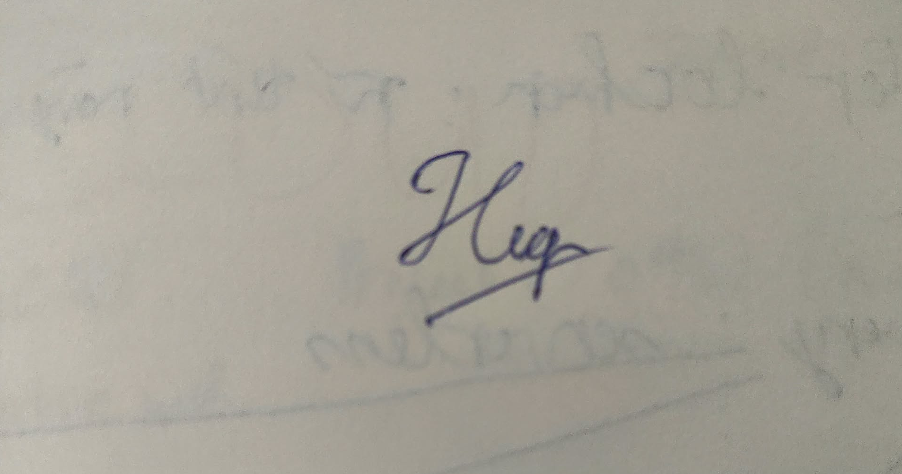

**Khoa Công nghệ Thông tin (FIT) – Trường Đại học Khoa học Tự nhiên (HCMUS)**

**CS423 / CSC13003 – Kiểm chứng Phần mềm (AI-augmented · 2026)**

**CHÍNH SÁCH AI · BIỂU MẪU — 2026 v1.0**

# Biểu mẫu Khai báo Sử dụng AI

*Đính kèm cho mọi bài tập có dùng AI ở bất kỳ mức nào.*

*Tài liệu được biên soạn lại từ Med Kharbach, PhD (2026) — Mẫu Chính sách Sử dụng AI cho Giáo dục Đại học. Giấy phép CC BY-NC-SA 4.0. Phiên bản này được FIT@HCMUS điều chỉnh cho môn CS423 / CSC13003 Kiểm chứng Phần mềm.*

## 1. Thông tin Môn học & Sinh viên

| Mục               | Giá trị                                |
|-------------------|----------------------------------------|
| Môn học:          | CS423 / CSC13003 – Kiểm chứng Phần mềm |
| Mã bài tập:       | Seminar T10, Nhóm 12                   |
| Tên bài tập:      | T10: Mutation Testing & Test Effectiveness |
| Cấp độ AI (1–5):  | Cấp 5                                  |
| Ngày:             | 23/10/2026                             |
| Họ tên sinh viên: | Lê Tấn Hiệp                            |
|                   |                                        |
| MSSV:             | 23120255                               |

## 2. Câu hỏi Khai báo

### 1. Công cụ AI đã dùng:

*Liệt kê mọi công cụ AI dùng cho bài tập này (ví dụ AI Tool (e.g., ChatGPT, Claude, Gemini), ChatGPT, GitHub Copilot, Cursor, Gemini).*

- Claude (claude.ai) — Claude Sonnet 4.6: hai lượt đầu ngày 16/10/2026 (đọc workbook, tra docs/papers cho S3-A01).
- Claude (claude.ai) — Claude Opus 5.5: phiên thảo luận S3 (nghiên cứu, soạn test Cart & Orders, soạn prompt cho Claude Code, spec review, phân tích kết quả, handoff).
- Claude (claude.ai) — Claude Sonnet 5.5: S4 (soạn Guide, Report và Demo contribution phần Cart & Orders, kiểm chứng handoff).
- Claude Code — Claude Opus 5.5 (`claude-opus-5-5`): S3–S4 (chạy Jest/StrykerJS, lưu evidence, sinh assertion AI ở S3-G01, so sánh mutant giữa các run, ghép và kiểm User Guide, trích prompt log).
- Không dùng ChatGPT, GitHub Copilot, Cursor hay Gemini.

### 2. Giai đoạn nào của bài tập có dùng AI:

*Tick tất cả: [ ] brainstorm [ ] outline [ ] viết nháp [ ] phản hồi [ ] sửa chữa [ ] code [ ] phân tích dữ liệu [ ] thiết kế đồ hoạ [ ] khác (ghi rõ).*

[x] brainstorm [x] outline [x] viết nháp [x] phản hồi [x] sửa chữa [x] code [x] phân tích dữ liệu [ ] thiết kế đồ hoạ [x] khác: chạy lệnh Jest/StrykerJS và lưu evidence, dịch tài liệu sang tiếng Việt, trích prompt log.

S3: nghiên cứu khái niệm và công cụ (A01, B01), sinh assertion tutorial (C01), viết harness/baseline/defect test Cart & Orders (D01), sinh assertion AI cho 6 survivor (G01), ghi Experiment Log, so sánh member run với run của Claude Code (E01, I01). S4: soạn nháp Guide/Report/Demo contribution, chạy lại guide (F01a, F01c, D01-1-cc), ghép User Guide và viết Verification Notes.

### 3. Prompt / nhiệm vụ chính cho AI:

*Dán nguyên văn 2–3 prompt quan trọng nhất. Để xem đầy đủ, đính kèm Phụ lục A (prompt_log.md).*

Prompt 1 — S3-C01, sinh assertion cho surviving mutant (Claude, Claude Opus 5.5; trích phần Task):

~~~text
Task:
1. Explain which input makes the original and the mutant behave differently.
2. Propose 1–3 assertions (Jest code) that pass on the original code and fail on this mutant.
3. Base expected values on the business requirement, not on the current implementation.
   If the code contradicts the requirement, say so instead of asserting the code's behaviour.
4. Only use APIs that exist in the code above.
~~~

Prompt 2 — S3-G01, sinh assertion AI cho 6 survivor Cart & Orders (Claude Code, Claude Opus 5.5; trích):

~~~text
Task S3-G01 — AI assertions, run G01-1-cc (skill t10-run-report). Session mới, blind với nhánh manual.
[…]
Với mỗi mutant: đọc diff và coveredBy trong mutation.json, giải thích vì sao baseline không kill, rồi viết test vào backend/test/ai/cart-orders.ai.js. Expected phải lấy từ SRS/spec; nếu phải lấy từ code thì ghi rõ trong comment. Test phải pass trên code gốc. Nếu không viết được test vừa đúng spec vừa pass trên code gốc thì không viết,
~~~

Prompt 3 — S3-WF-01, sửa giả định workspace (Claude, Claude Opus 5.5):

~~~text
Có gì đó sai sai ở đây, mình không hề sử dụng ở thư mục ngày. Mình đặt hết vào thư mục cha là: "Repo". Không biết cần thay đổi gì không
~~~

Toàn bộ prompt và output nguyên văn nằm trong prompt log claude.ai và Claude Code đính kèm ở Phụ lục A.

### 4. Phần cụ thể AI đóng góp:

*Càng cụ thể càng tốt. Ví dụ: 'AI sinh TC01–TC15 ở Mục 3.2; tôi viết lại TC04 và TC11; AI KHÔNG đóng góp vào Mục 1, 2, 4, hoặc AI Critique.'*

- S3-A01/B01: AI soạn Research Notes F-A01-01…05, F-B01-01…04 và Source Register; em sửa F-B01-04 theo SRS (FR-07, SRC-14) và đổi seam sang mock test-only.
- S3-C01: AI sinh 3 test Jest cho tutorial `calcCartTotal`; em dùng nguyên code, chỉ thêm wrapper cho dòng expect tùy chọn và loại một câu giải thích sai. AI soạn Experiment Log C01 và `.gitignore` từ output em tự chạy.
- S3-D01: AI viết harness test-only, 36 baseline test CO-01…CO-19 và defect test DEF-01…DEF-08 (sau tách DEF-08a/08b); em chốt expected theo SRS, baseline chỉ assert status, defect tách khỏi baseline.
- S3-G01: AI sinh 5 test AI-CO-01…05; assertion giữ nguyên, em chỉ sửa header provenance.
- S3-E01, S3-I01: AI soạn lệnh member run, viết script so từng mutant, ghi log; em tự chạy D01-1/2/3, E01-1, F01-2, G01-2, I01-1/2/3.
- S4: AI soạn Guide/Report/Demo contribution phần Cart, ghép `User_Guide.md`, viết Verification Notes và script kiểm số liệu; em tự chạy D01-1 (reproduction Coupons).
- AI KHÔNG đóng góp: bộ assertion manual S3-F01 (em tự viết), quyết định scope/oracle, các run member, kết luận so sánh manual/AI và bài suy ngẫm AI-04 Q5.

### 5. Cách tôi rà soát / chỉnh sửa / xác minh đầu ra AI:

*Mô tả phương pháp xác minh (chạy test, kiểm tra spec, hỏi TA, tra RFC, đối chiếu ISTQB syllabus, v.v.).*

- Tính tay expected theo requirement/SRS trước khi chấp nhận assertion (G1), chạy Jest trên code gốc (G2), chạy StrykerJS và đọc `killedBy` trong `mutation.json` để xác nhận mutant thật sự bị kill (G3).
- Đối chiếu mọi oracle với SRS v2.0 (`README.md`) và `api_specification.md`; chỗ nào oracle lấy từ code phải ghi rõ nguồn trong comment test.
- Tự chạy lại các run chính thức trên máy cá nhân (Windows 11, Node v24) và so từng mutant (location + mutator + replacement) với run của Claude Code; tập Survived trùng ở cả 6 cặp, I01 khớp 120/120.
- Tách Killed khỏi Timeout khi so sánh; giả thuyết nào bị dữ liệu bác bỏ thì ghi là bác bỏ (concurrency, Jest testTimeout).
- Với tài liệu S4: chạy lại guide trên clone mới (F01c-1-cc khớp 4 mốc), dùng script so 36 claim số liệu, 31 code block và 51 link trong User Guide; đọc `git diff` trước mỗi commit.
- Kiểm handoff/tài liệu bàn giao bằng trạng thái repo thật (hash nhánh, số dòng), không tin lời AI khi chưa đối chiếu.

### 6. Trích dẫn (nếu môn yêu cầu):

*Môn Kiểm chứng Phần mềm dùng phong cách IEEE. Ví dụ: Anthropic. (2026). AI Tool (e.g., ChatGPT, Claude, Gemini) \[Large language model\]. https://claude.ai*

[1] Anthropic, "Claude (Claude Opus 5.5)," Large language model, claude.ai, 2026. [Online]. Available: https://claude.ai. Accessed: Oct. 16–23, 2026.

[2] Anthropic, "Claude (Claude Sonnet 4.6)," Large language model, claude.ai, 2026. [Online]. Available: https://claude.ai. Accessed: Oct. 16, 2026.

[3] Anthropic, "Claude (Claude Sonnet 5.5)," Large language model, claude.ai, 2026. [Online]. Available: https://claude.ai. Accessed: Oct. 23, 2026.

[4] Anthropic, "Claude Code (Claude Opus 5.5)," AI coding agent, 2026. [Online]. Available: https://claude.com/claude-code. Accessed: Oct. 22–23, 2026.

## 3. Cam đoan Trung thực

*Bằng việc ký tên dưới đây, tôi cam đoan thông tin khai báo ở trên là chính xác và đầy đủ. Tôi hiểu rằng việc không khai báo hoặc khai báo sai lệch về việc dùng AI sẽ bị coi là vi phạm liêm chính học thuật và có thể dẫn đến điểm 0 cho bài tập cùng việc bị chuyển lên hội đồng kỷ luật.*

## Chữ ký

| Họ tên sinh viên (in hoa): | LÊ TẤN HIỆP                            |
|----------------------------|----------------------------------------|
| MSSV:                      | 23120255                               |
| Lớp / Khoá:                | Software Testing - CQ2023/3            |
| Môn học:                   | CS423 / CSC13003 – Kiểm chứng Phần mềm |
| Giảng viên:                | Dr. Lam Quang Vu / Dr. Tran Duy Hoang / MSc. Tran Thi Bich Hanh / MSc. Truong Phuoc Loc / MSc. Ho Tuan Thanh |
| Ngày:                      | 23/10/2026                             |
| Chữ ký:                    |           |

## Tham khảo

- Kharbach, M. (2026). AI Use Policy Templates for Higher Education. CC BY-NC-SA 4.0.

- ISTQB Foundation Level Syllabus (latest version).

- Hardman, P. (2025). A Post-AI Learning Taxonomy.

- Fuster Rabella, M. (2025). OECD Education Working Paper No. 338.

- Perkins, M., Roe, J., & Furze, L. (2025). AI Assessment Scale.

- Anthropic (2025). Building reliable AI test agents — engineering blog.

- DeepEval & Promptfoo documentation — testing frameworks for LLM systems.
