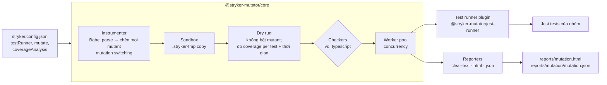
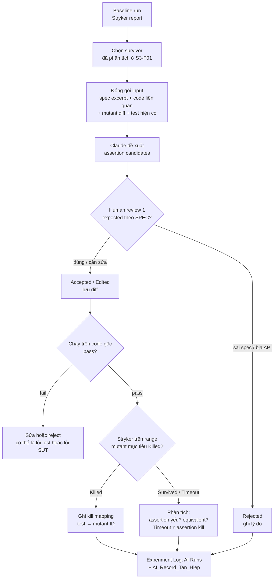

# Theory & Tool Research Notes

**Document Role:** Research notes cá nhân S3; đầu vào cho S4-B01 (report) và S4-A01 (guide). Chưa phải report hoàn chỉnh.  
**Stage:** S3  
**Member:** Lê Tấn Hiệp  
**Task IDs:** S3-A01, S3-B01  
**Domain / Section:** Theory — Definitions, Operators & Workflow (A01); Stryker + Claude — Architecture & Workflow (B01). Domain SUT: Cart & Orders.  
**Evidence Status:** Draft — literature/docs đã đối chiếu; ví dụ F-A01-04 đã được Tấn Hiệp chạy lại ở S3-C01 (C01-2, C01-4), kết quả khớp. **Sửa 2026-10-18:** F-A01-02 (nhận xét), Q9, F-B01-04 và Open questions — trước đó bỏ sót `README.md` là đặc tả yêu cầu (SRS) của SUT.

Ranh giới với notes teammate: coverage vs mutation score và chi tiết mutant states thuộc S3-A02 (Thái Hòa); equivalent mutants, limits và AI approaches thuộc S3-A03 (Phúc Hoàng). Notes này chỉ nhắc ngắn khi cần để giải thích.

## Questions & Inputs

| Question | Requirement / Source | Answer / Finding | Verification / Pending |
|---|---|---|---|
| Q1. Mutation testing, mutant, operator, killed/survived là gì? | T10 §2; [SRC-01], [SRC-05] | Xem F-A01-01 | Đối chiếu Jia & Harman và Stryker docs |
| Q2. Vì sao chỉ cần đột biến nhỏ? | [SRC-01], [SRC-02] | CPH + Coupling Effect — F-A01-01 | Literature only |
| Q3. StrykerJS có những mutation operators nào; operator nào liên quan Cart & Orders? | [SRC-06] | Bảng F-A01-02; mapping vào code EShop thật ở F-B01-04 | Mapping là source inspection, chưa chạy Stryker trên EShop |
| Q4. Quy trình mutation testing gồm những bước nào? | [SRC-01], [SRC-07] | F-A01-03 | Đối chiếu config docs |
| Q5. Ví dụ nhỏ có expected result? | T10 §2 | F-A01-04: coverage 100%, score 20% → 93.33% | Chạy bởi Claude trong sandbox; **Pending: Tấn Hiệp tự chạy lại ở S3-C01** |
| Q6. Industry áp dụng thế nào? | Reading list T10; [SRC-03], [SRC-04] | F-A01-05 | Literature only |
| Q7. Kiến trúc StrykerJS: các thành phần và luồng chạy? | [SRC-07], [SRC-08], [SRC-09], [SRC-10] | F-B01-01 | Docs; chưa debug nội bộ |
| Q8. Claude tham gia ở đâu, cần input gì, human verification thế nào? | Proposal S2 §3.2, §4.3; [SRC-11] | F-B01-02, F-B01-03 | Workflow **Proposed** — chưa chạy trên EShop (S3-G01) |
| Q9. EShop backend có sẵn sàng cho Stryker chưa? | `SUT/backend/server.js`, `database.js`, `package.json`, `README.md` (SRS) @ `85af3ba` | F-B01-04: cần cô lập app/DB; làm được bằng test-only mocks, không sửa production code | Kiểm chứng bằng run trong S3-D01 (Experiment Log) |

## Findings & Examples

### F-A01-01 — Definitions & Terminology

Code coverage chỉ trả lời "dòng code có được chạy không". Mutation testing hỏi tiếp "nếu dòng này sai, test có phát hiện không". Vì vậy nó đo **độ nhạy của test**, cụ thể là chất lượng **test oracle** (các `expect` trong Jest).

| Term | Giải thích | Ví dụ |
|---|---|---|
| Mutation testing | Kỹ thuật fault-based: sinh các phiên bản lỗi nhỏ của chương trình rồi dùng chúng để đánh giá/cải thiện test suite [SRC-01] | — |
| Mutation analysis | Phần đo lường (sinh mutants, tính kết quả). Mutation testing dùng mutants làm mục tiêu để viết test [SRC-04] | — |
| Mutant | Bản sao chương trình khác bản gốc đúng một thay đổi cú pháp | `a > b` → `a >= b` |
| Mutation operator / mutator | Quy tắc sinh mutant | `EqualityOperator` |
| First-/Higher-order mutant | FOM có 1 thay đổi (Stryker chỉ sinh loại này); HOM gộp ≥2 thay đổi, chủ yếu trong nghiên cứu [SRC-01] | — |
| Killed / Survived | Có test fail khi mutant bật / mọi test vẫn pass [SRC-05] | — |
| Test oracle | Phần quyết định pass/fail | `toBe(230000)` mạnh hơn `toBeGreaterThan(0)` |

**Hai giả thuyết nền tảng** [SRC-01], [SRC-02]:

1. **Competent Programmer Hypothesis:** code của lập trình viên có năng lực thường gần đúng; lỗi thật là sai lệch nhỏ → chỉ cần mô phỏng lỗi nhỏ.
2. **Coupling Effect:** test bắt được lỗi đơn giản thì cũng bắt được phần lớn lỗi phức tạp → chỉ cần first-order mutants.

**Strong vs weak mutation:** strong so sánh kết quả cuối (Stryker: mutant killed khi có test fail); weak so sánh trạng thái ngay sau điểm đột biến, rẻ hơn nhưng yếu hơn [SRC-01].

### F-A01-02 — Mutation Operators

Mỗi operator mô phỏng một kiểu lỗi thường gặp: sai phép tính, sai biên (off-by-one), sai điều kiện, thiếu code, sai dữ liệu trả về. Bảng dưới chọn các mutators StrykerJS [SRC-06] liên quan Cart & Orders. Cột "EShop" chỉ ra dòng code thật ở commit `85af3ba` (xem F-B01-04).

| Mutator | Biến đổi | EShop (source inspection) | Test cần có để kill |
|---|---|---|---|
| EqualityOperator | Boundary `<`↔`<=`, `>`↔`>=`; negation `===`↔`!==`… | `order.status === "delivered"` (server.js:329) | Test từng giá trị status, cả hai phía điều kiện |
| ConditionalExpression | Thay điều kiện bằng `true`/`false` | Điều kiện chặn hủy đơn (server.js:329); `if (!order)` (326) | Test cả nhánh bị chặn lẫn nhánh cho phép |
| LogicalOperator | `&&`↔`\|\|`, `??`→`&&` | Bảng chuyển trạng thái (server.js:537–551) | Test trường hợp chỉ một vế đúng |
| StringLiteral | `"foo"`→`""` | `"canceled"`, `"pending"`, message lỗi (303, 335) | Assert đúng chuỗi status trong DB/response |
| ObjectLiteral | `{...}` → `{}` | Response `{ message, orderId }` (306) | Assert field `orderId` |
| BlockStatement | Xóa nội dung `{...}` | Callback `UPDATE orders` (333–339) | Assert side effect: status trong DB đổi thật |
| BooleanLiteral | `true`↔`false` | `isValidTransition = true` (541…) | Test transition hợp lệ được chấp nhận |
| ArithmeticOperator, AssignmentOperator, UpdateOperator, MethodExpression, OptionalChaining, ArrayDeclaration, Regex, UnaryOperator | Xem [SRC-06] | Không thấy vị trí rõ trong routes Cart & Orders | — |

**Nhận xét quan trọng (sửa 2026-10-18):** `api_specification.md` không nêu rule cho cart/checkout, nhưng `README.md` (SRS) có: FR-07 thêm cùng sản phẩm phải tăng số lượng; FR-08 backend phải tự tính lại tổng tiền, không nhận `total_amount` từ client, và xóa giỏ sau checkout. Code `POST /api/cart`, `POST /api/checkout` **không triển khai** các rule này, nên chúng là lỗi gốc (DEF-01…03 trong Experiment Log), không phải "không có gì để test". Mutants của domain vẫn tập trung ở cancel và admin status transition vì đó là nơi code có logic điều kiện.

### F-A01-03 — Workflow

Quy trình tổng quát [SRC-01]:

1. Chạy test suite trên chương trình gốc; **phải pass** trước khi đo (→ lý do S3-D04 chốt baseline trước).
2. Áp operators sinh mutants.
3. Chạy test trên từng mutant → Killed / Survived.
4. Phân tích survivor: lỗ hổng thật → thêm assertion và chạy lại; nghi tương đương → equivalent candidate.
5. Tính mutation score, dừng khi đạt ngưỡng chấp nhận.

StrykerJS hiện thực quy trình này: dry run tương ứng bước 1, mutant runs tương ứng bước 3, report tương ứng bước 4–5 (chi tiết F-B01-01).

### F-A01-04 — Worked Example (run evidence: sandbox AI, not member run)

> Run bởi Claude trong sandbox, 2026-10-16: Node v22.22.0, `@stryker-mutator/core` 10.0.0, `@stryker-mutator/jest-runner`, Jest, `coverageAnalysis: perTest`. Đây **không phải** evidence S3-C01; Tấn Hiệp tự chạy lại bằng commands ở cuối section, ghi số thật vào Experiment Log.

Code minh họa (không phải code EShop):

```js
// src/cart.js
function calcCartTotal(items, shippingFee) {
  let subtotal = 0;
  for (const item of items) {
    if (item.quantity > 0) {
      subtotal += item.price * item.quantity;
    }
  }
  const freeShip = subtotal >= 500000;
  return freeShip ? subtotal : subtotal + shippingFee;
}
module.exports = { calcCartTotal };
```

**Run 1 — weak test** (`expect(calcCartTotal([{ price: 100000, quantity: 2 }], 30000)).toBeGreaterThan(0)`):

| Metric | Result |
|---|---|
| Jest statement / line / branch coverage | 100% / 100% / 50% |
| Mutants / Killed / Survived / Timeout / NoCoverage | 15 / 3 / 12 / 0 / 0 |
| Stryker mutation score | 20.00% |

| Survivor (diff) | Actual với input trên | Vì sao sống |
|---|---|---|
| `price * quantity` → `price / quantity` | 80.000 (gốc 230.000) | Vẫn `> 0` |
| `subtotal + shippingFee` → `subtotal - shippingFee` | 170.000 | Vẫn `> 0` |
| BlockStatement xóa body `if` | 30.000 | Vẫn `> 0` |
| `subtotal >= 500000` → `subtotal > 500000` | 230.000 (giống gốc) | Không có test đúng tại ngưỡng |

3 mutant bị kill: `+=` → `-=` (tổng âm), xóa thân hàm (trả `undefined`), `module.exports = {}` (không gọi được hàm).

**Run 2 — strong tests:**

| Test | Expected (tính tay theo code gốc) | Kill nhóm |
|---|---|---|
| 2 × 100.000, ship 30.000 | `toBe(230000)` | Sai phép tính, `freeShip = true` |
| 2 × 250.000 (đúng ngưỡng 500.000) | `toBe(500000)` | `>=`→`>`, `freeShip = false` |
| quantity −1 và 1 × 50.000 | `toBe(80000)` | `if (true)` |

Kết quả: 15 mutants, **Killed 14, Survived 1, score 93.33%**.

Survivor còn lại: `quantity > 0` → `quantity >= 0`. Khác biệt chỉ ở `quantity === 0`, khi đó mutant cộng thêm `price × 0 = 0` → output giống gốc (với `price` hữu hạn). Đây là **equivalent candidate** — có thể chuyển cho S3-A03 làm ví dụ.

**Assertion design lessons** (dùng cho S3-D01/F01):

1. Assert giá trị chính xác, không chỉ "> 0" hay "không rỗng".
2. Test đúng tại biên của mọi phép so sánh.
3. Test cả hai nhánh của điều kiện, kể cả input không hợp lệ.
4. Assert response body **và** side effect (DB), không chỉ status code.

Reproduce:

```bash
npm init -y && npm i -D jest @stryker-mutator/core @stryker-mutator/jest-runner
# src/cart.js, test/cart.weak.test.js, test/cart.strong.test.js như trên
```

```json
{
  "testRunner": "jest",
  "coverageAnalysis": "perTest",
  "mutate": ["src/**/*.js"],
  "reporters": ["clear-text", "html", "json"],
  "jsonReporter": { "fileName": "reports/weak.json" },
  "jest": { "config": { "testMatch": ["**/test/cart.weak.test.js"] } }
}
```

```bash
npx stryker run stryker.weak.config.json
npx jest test/cart.weak.test.js --coverage
```

Bản strong: đổi `weak` → `strong` trong `fileName` và `testMatch`. Số khác do version thì ghi số thật, không chỉnh cho khớp notes.

### F-A01-05 — Industry Practice (Google)

[SRC-03], [SRC-04]: mutation testing truyền thống quá tốn và trả nhiều mutant vô ích. Google:

- Chỉ đột biến dòng **thay đổi trong code review** (diff-based).
- Bỏ dòng không có statement coverage và **arid nodes** (ví dụ logging).
- Chọn mutants theo xác suất dựa trên hiệu quả lịch sử của operator.
- Hiển thị kết quả ngay trong code review.

Quy mô: năm 2018, hệ thống được 6.000 kỹ sư dùng khi viết hoặc review code change, và xử lý khoảng 30% số diff của Google **đã có statement coverage được tính** (mẫu số là các diff có coverage, không phải toàn bộ diff; abstract [SRC-03]: "processes about 30% of all diffs across Google that have statement coverage calculated"). Năm 2021: hơn 24.000 developer trên hơn 1.000 project [SRC-04].

Áp dụng cho EShop: giới hạn `mutate` theo domain bằng mutation range dòng (`"server.js:321-349"`) vì backend gom routes trong một file; khi chọn survivor, bỏ qua mutants trong `console.log`/message không quan trọng — tương tự ý tưởng arid nodes.

### F-B01-01 — StrykerJS Architecture



| Component | Vai trò | Config / ghi chú cho nhóm |
|---|---|---|
| Core | Điều phối toàn bộ run | `npx stryker run [config]` |
| Instrumenter | Parse code bằng Babel, chèn **tất cả** mutants vào code cùng lúc; mỗi mutant bật/tắt bằng ID lúc chạy (mutation switching) [SRC-10] | Không build lại cho từng mutant → nhanh |
| Sandbox | Copy project vào `.stryker-tmp`; `inPlace: false` mặc định [SRC-07] | Code thật không bị sửa. Lưu ý `database.sqlite` cũng bị copy (F-B01-04) |
| Dry run | Chạy test không bật mutant; fail thì dừng; đo `netTime`, coverage [SRC-07] | `--dryRunOnly` dùng để kiểm tra harness ở S3-C01 |
| Coverage analysis | `off` / `all` / `perTest` (mặc định) [SRC-07] | `perTest` chỉ chạy test cover mutant; với Jest chỉ hỗ trợ jest-circus/jasmine2 [SRC-08] |
| Static mutants | Mutant chạy lúc load file (không trong test) → Stryker phải chạy toàn bộ test cho nó [SRC-07] | Code ở top-level `server.js` (ví dụ `SECRET_KEY`, `const userCarts = {}`) là static |
| Checkers | Loại mutant không hợp lệ trước khi chạy (vd. TS type errors) [SRC-09] | EShop là JS thuần → không cần |
| Test runner plugin | Nối Stryker với framework; `command` runner không hỗ trợ coverage analysis [SRC-07] | Đề xuất `jest` runner thay vì `npm test` |
| Workers | Chạy song song; mặc định n hoặc n−1 nhân CPU [SRC-07] | Test dùng chung DB file sẽ xung đột nếu nhiều worker → cần DB riêng mỗi worker |
| Timeout | `netTime × timeoutFactor + timeoutMS + overhead`, mặc định 1.5 và 5000 ms [SRC-07] | Báo `Timeout` riêng theo Experiment Contract |
| Reporters | clear-text, progress, html, json, dashboard… [SRC-09] | Lưu HTML + JSON vào `experiments/s3/runs/Tan_Hiep/<Run_ID>/` |
| Thresholds | high 80 / low 60 / break null [SRC-07] | Chỉ ảnh hưởng màu và exit code |

**Công cụ thu hẹp phạm vi** (quan trọng cho so sánh manual vs Claude):

- `mutate` với mutation range dòng: `"server.js:321-342"` [SRC-07].
- `--testFiles` giới hạn test file chạy [SRC-07].
- Comment `// Stryker disable next-line <Mutator>: <reason>` → mutant thành **Ignored**, không tính vào score [SRC-12]. Không dùng để "dọn" survivors khi so sánh; nếu dùng phải ghi lý do.
- `incremental` tiết kiệm thời gian nhưng có rủi ro kết quả cũ [SRC-07]; khi chốt số so sánh nên chạy full.

### F-B01-02 — Claude Assertion Workflow (Proposed)

Theo proposal S2 §4.3: hai nhánh manual và Claude bắt đầu **độc lập từ cùng baseline**; lời giải thủ công **không** đưa vào prompt.



Prompt skeleton đề xuất (sẽ chỉnh và lưu **nguyên văn** mỗi lần dùng ở S3-G01):

```text
You are helping write Jest + supertest assertions for an Express backend.

Business requirement (source of truth):
<dán đoạn spec, vd. API spec §4.6>

Relevant production code (do not change it):
<dán route liên quan>

Existing test:
<dán test hiện có>

A mutation testing tool produced this SURVIVING mutant:
<dán diff của mutant, file:line, mutator name>

Task:
1. Explain which input makes the original and the mutant behave differently.
2. Propose 1–3 assertions (Jest code) that pass on the original code and fail on this mutant.
3. Base expected values on the business requirement, not on the current implementation.
   If the code contradicts the requirement, say so instead of asserting the code's behaviour.
4. Only use APIs that exist in the code above.
```

Lý do thiết kế: câu 3 chống failure mode "assertion học theo bug hiện tại" (Tool Survey Table 6); câu 4 chống bịa field/API; câu 1 buộc Claude nêu distinguishing input để người review đối chiếu.

### F-B01-03 — Human Verification Gates

| Gate | Câu hỏi | Evidence cần lưu |
|---|---|---|
| G1 — Spec review | Expected value có căn cứ ở spec không? Có học theo bug không? | Section spec được dẫn; verdict accepted/edited/rejected |
| G2 — Original run | Test pass trên code gốc (baseline commit)? | Jest log |
| G3 — Target kill | Mutant mục tiêu chuyển `Survived` → `Killed` (không phải `Timeout`)? | Stryker JSON/HTML, mutant ID |
| G4 — Side effects | Kill do assertion nghiệp vụ, không do lỗi setup/data? | Đọc test fail message trong report |
| G5 — Record | Raw prompt/output, bản sửa, kết quả | `AI_Record_Tan_Hiep.md`, Experiment Log mục AI Runs |

Claude nói "assertion này sẽ kill mutant" **không phải evidence**; chỉ G2 + G3 là evidence.

### F-B01-04 — EShop Fit (source inspection @ `85af3ba`; sửa 2026-10-18)

**Bản trước (2026-10-16) bỏ sót `README.md`.** File này là SRS của SUT: *"Mô tả yêu cầu nghiệp vụ đúng của hệ thống EShop. Sinh viên sử dụng tài liệu này làm cơ sở thiết kế test case, sau đó kiểm thử hệ thống thực để tìm ra các điểm triển khai không tuân thủ đặc tả"* (README §Phạm vi tài liệu). Repo gốc `ttbhanh/eshop-sut` và fork của nhóm giống hệt nhau (trừ `.gitignore`). Các sai khác code/spec dưới đây vì vậy là **lỗi cài sẵn có chủ đích**, được giữ nguyên trong SUT và ghi là lỗi gốc.

| Observation | File:line | Requirement | Xử lý trong S3-D01 |
|---|---|---|---|
| `npm test` là placeholder báo lỗi | `package.json` | — | Thêm `jest`, `supertest`, `@stryker-mutator/*` (devDependencies, pin version) |
| `server.js` gọi `app.listen`, không export `app` | 570–572 | — | Test-only: mock `express` để lấy instance `app` và thay `listen` bằng no-op. **Không sửa production code** |
| `database.js` DROP + seed file `database.sqlite` mỗi lần được require; seed bất đồng bộ | 4, 13–117 | — | Test-only: mock `sqlite3` để mọi `Database` mở `:memory:` (mỗi test file một DB riêng, file đang track không bị sửa); helper đợi seed xong |
| Cart lưu trong biến global `userCarts` | 14 | — | Mỗi test dùng user mới đăng ký |
| `POST /api/cart` push nguyên body | 290–295 | FR-07: thêm cùng sản phẩm phải tăng số lượng | Lỗi gốc DEF-01 |
| `POST /api/checkout` lưu `total_amount` của client, không xóa giỏ | 297–309 | FR-08: backend tự tính tổng, xóa giỏ sau checkout | Lỗi gốc DEF-02, DEF-03 |
| Cancel chỉ chặn `delivered`/`canceled` (comment: lẽ ra chỉ cho `pending`/`confirmed`) | 328–329 | FR-10, FR-20: chỉ hủy khi `pending` hoặc `confirmed` | Lỗi gốc DEF-04 |
| Admin cho phép `canceled → delivered` | 550–551 | FR-10: `delivered`, `canceled` là trạng thái kết thúc | Lỗi gốc DEF-05 |
| Admin routes chỉ `authenticateToken`, không kiểm role | 510, 525 | FR-12, SEC-03 | Lỗi gốc DEF-06, DEF-07 |
| `GET /api/orders/:id` không yêu cầu token, không kiểm chủ đơn | 344 | spec §4 (header), FR-11 | Lỗi gốc DEF-08 |
| FR-10: "Khi `shipping`… chỉ Admin mới có thể thao tác" | README FR-10 | Sơ đồ không có cạnh `shipping → canceled` | Chưa rõ admin có được hủy đơn `shipping` không → loại khỏi cả hai suite, ghi open point |

## Source Register

| ID | Title / Author | URL / File & Section | Claim Supported | Access Date |
|---|---|---|---|---|
| SRC-01 | Y. Jia, M. Harman, "An Analysis and Survey of the Development of Mutation Testing," IEEE TSE 37(5):649–678, 2011 | https://doi.org/10.1109/TSE.2010.62 | Định nghĩa, CPH, Coupling Effect, quy trình, strong/weak, HOM | 2026-10-16 |
| SRC-02 | R. A. DeMillo, R. J. Lipton, F. G. Sayward, "Hints on Test Data Selection," Computer 11(4), 1978 (dẫn qua SRC-01) | — | Nguồn gốc Coupling Effect | Not accessed directly |
| SRC-03 | G. Petrović, M. Ivanković, "State of Mutation Testing at Google," ICSE-SEIP 2018 | https://research.google/pubs/pub46584/ | Diff-based, arid lines, 6.000 kỹ sư, ~30% các diff đã có statement coverage | 2026-10-16 |
| SRC-04 | G. Petrović et al., "Practical Mutation Testing at Scale: A view from Google," IEEE TSE 2021 | https://research.google/pubs/pub50658/ | Mutation testing vs analysis; >24.000 developers | 2026-10-16 |
| SRC-05 | Stryker — Mutant states and metrics | https://stryker-mutator.io/docs/mutation-testing-elements/mutant-states-and-metrics/ | States, công thức score | 2026-10-16 |
| SRC-06 | Stryker — Supported mutators | https://stryker-mutator.io/docs/mutation-testing-elements/supported-mutators/ | Danh sách mutators StrykerJS | 2026-10-16 |
| SRC-07 | StrykerJS — Configuration | https://stryker-mutator.io/docs/stryker-js/configuration/ | coverageAnalysis, mutate range, sandbox, timeout, concurrency, static mutants, incremental, thresholds | 2026-10-16 |
| SRC-08 | StrykerJS — Jest runner | https://stryker-mutator.io/docs/stryker-js/jest-runner/ | Cài đặt, `perTest` chỉ với jest-circus/jasmine2, test environment | 2026-10-16 |
| SRC-09 | StrykerJS — Plugins | https://stryker-mutator.io/docs/stryker-js/plugins/ | Test runner, reporter, checker, ignorer | 2026-10-16 |
| SRC-10 | "Announcing Stryker 4.0: Mutation Switching," Angular In Depth | https://angularindepth.com/article/announcing-stryker-4-0-mutation-switching/ | Cơ chế mutation switching | 2026-10-16 |
| SRC-11 | T10 Seminar Proposal (S2), §3.2, §4.3; Tool Survey Proposal Table 6 | `proposal/s2/T10_Seminar_Proposal.md`, `proposal/s2/Tool_Survey_Proposal.md` | Vai trò Claude, thiết kế so sánh, failure modes | 2026-10-16 |
| SRC-12 | StrykerJS — Disable mutants | https://stryker-mutator.io/docs/stryker-js/disable-mutants/ | Comment syntax, trạng thái Ignored | 2026-10-16 |
| SRC-13 | EShop backend source, commit `85af3ba` | `SUT/backend/server.js`, `database.js`, `package.json`; `SUT/api_specification.md` §4, §6.2 | F-A01-02 cột EShop, F-B01-04 | 2026-10-16 |
| SRC-14 | EShop System Requirements Specification v2.0 (2026-05-14), `README.md` | `SUT/README.md` FR-07, FR-08, FR-10, FR-11, FR-12, FR-18, FR-20, SEC-03; repo gốc https://github.com/ttbhanh/eshop-sut | Expected results Cart & Orders, lỗi gốc DEF-01…08 | 2026-10-18 |

## Handoff

- Target stage / task / section: S4-B01 (report: theory, tool architecture, method); S4-A01 (guide: Introduction, First Test); S3-C01 (dùng F-A01-04 làm hello world); S3-D01/D04 (F-B01-04).
- Main conclusions:
  - Coverage cao không đảm bảo test nhạy — minh họa 100% line coverage vs 20% mutation score (sandbox run).
  - StrykerJS + jest-runner + `perTest` là cấu hình phù hợp; cần seams ở `server.js`/`database.js` trước khi chạy trên EShop.
  - Claude chỉ là nguồn candidates; kill phải được xác nhận bằng run (G2 + G3).
- Open questions:
  1. ~~Cart/checkout không có logic~~ → Đã giải quyết 2026-10-18: SRS FR-07/FR-08 có rule; code không triển khai → lỗi gốc.
  2. ~~Cancel khi `shipping`~~ → FR-10, FR-20: không được hủy → lỗi gốc DEF-04.
  3. ~~Sửa lỗi gốc hay ghi known defect~~ → Hòa: viết theo task được giao và ghi rõ; nhóm giữ nguyên SUT, test lỗi gốc để ở `test/defects/`, ngoài baseline.
  4. ~~Seams production code~~ → Không cần: cô lập bằng test-only mocks trong S3-D01.
  5. `docs/s2/Scope_and_Decisions.md` vẫn chưa có trong repo; S3 dựa vào proposal S2 và SRS.
  6. Admin có được hủy đơn `shipping` không (FR-10 câu "chỉ Admin mới có thể thao tác")? Chưa rõ, chưa test.
- AI record: `ai-audit/AI_Record_Tan_Hiep.md` — Artifact AI-S3-A01-01, AI-S3-B01-01.

## Report Outline Input

| Report section (S4) | Notes dùng |
|---|---|
| Background — Mutation testing concepts | F-A01-01, F-A01-03 |
| Background — Mutation operators | F-A01-02 (bỏ cột EShop hoặc thay bằng mutants thật sau S3-E01) |
| Motivation example ("coverage lies") | F-A01-04 — thay số sandbox bằng số run của Tấn Hiệp |
| Related work — Industry | F-A01-05 |
| Tools — StrykerJS architecture | F-B01-01 |
| Method — AI-assisted assertion workflow | F-B01-02, F-B01-03 |
| Threats / Limits — SUT preparation | F-B01-04 (harness test-only, lỗi gốc giữ nguyên) |
